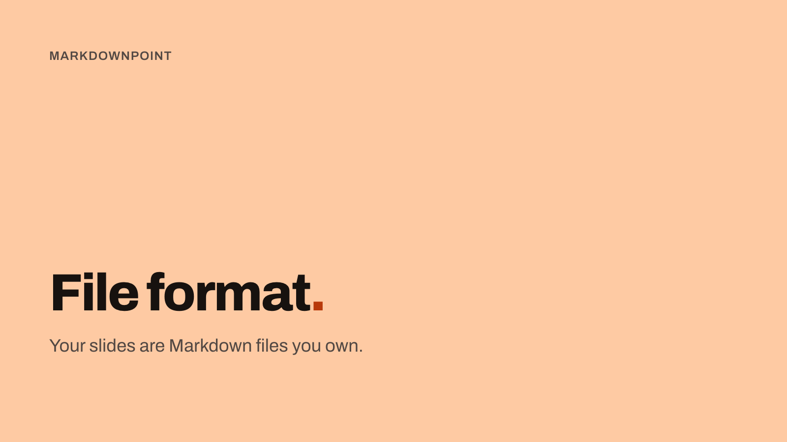

# MarkdownPoint file format

MarkdownPoint is a presentation app for Mac and Windows: [markdownpoint.com](https://markdownpoint.com).

Each presentation is a folder with two main files:

- `slides.md` contains the text, speaker notes, sections and slide order.
- `presentation.mdpoint` contains the layout, objects and animation as JSON.

Themes and media are stored in subfolders. You can edit the presentation in MarkdownPoint, in a text editor or with an AI agent.

## Write in Obsidian

Write your slide text and speaker notes in Obsidian with the [MarkdownPoint plugin](https://community.obsidian.md/plugins/markdownpoint). You can edit all the slides in one document. Use the outline to add or move slides.

Open the same presentation in MarkdownPoint to work on layout, images, 3D and animation. Both apps save to the same files. You can switch between them without importing or exporting.

Keep the presentation's whole folder in your vault and open `slides.md` in Obsidian's Live Preview. The [Markdown guide](md-file.md#writing-in-obsidian) explains the workflow.

## Slides and objects

Each slide has an ID. Its marker in `slides.md` and its entry in `presentation.mdpoint` use the same ID. Text blocks use the IDs of their objects. To move a slide, move its whole block in `slides.md`. Its ID stays the same.

Objects use the selected theme's fonts, color schemes, text styles and layouts. A slide can add objects and override properties inherited from its layout.

Text and image objects use a 2D frame for position and size. A 3D model has a position, rotation and scale. Keyframes animate object properties over time. The [reference](reference/v1.md#objects) lists each property's units, defaults and allowed values.

## A small presentation



The slide's Markdown is:

```markdown
<!-- slide: title -->

<!-- text: eyebrow -->
MarkdownPoint

<!-- text: title -->
File format==.==

<!-- text: body -->
Your slides are Markdown files you own.

<!-- notes -->
Speaker notes go here. Only the presenter sees them.
```

The [complete presentation](examples/first-deck) includes the theme and JSON file.

## Guides

- **[The .md file](md-file.md)**: write the words, arrange slides and add speaker notes. Start here when editing a presentation by hand.
- **[The .mdpoint file](mdpoint-file.md)**: place objects, set their properties and animate them.
- **[Themes](themes.md)**: share fonts, colors, text styles and layouts across slides.
- **[Reference, version 1](reference/v1.md)**: look up a key's exact meaning, values, units and defaults.

## Files and folders

```
My talk/
  slides.md              text, notes, sections and slide order
  presentation.mdpoint   objects, layout, styles and animation
  media/                 imported images, videos, sounds and models
  generated/             generated images, 3D text models and image generation records
  themes/<key>/          master.json, layout files, fonts and images
  versions/              saved versions and versions.json
```

Media and theme resources use relative paths. Move the whole folder when moving a presentation. Rename the folder to rename the presentation.

Keep one `slides.md` and one `presentation.mdpoint` at the folder's root. File names are case-insensitive. MarkdownPoint won't open a folder containing duplicate copies, such as `slides 2.md` or a sync service's conflicted copy. Resolve any duplicates before opening the presentation.

Unrelated files in the folder are not copied by MarkdownPoint. Symbolic links and aliases aren't supported. Copy the original files into the folder.

To start a presentation by hand, copy an example's whole folder. Its `themes` folder holds Basic. With MarkdownPoint running, `mdpoint create <folder>` makes a new presentation with Basic and opens it.

## Saved versions

“File › Save Version…” saves a copy of the slides, text, objects and settings. The version uses the presentation's media and the theme named in its saved file. Changes to those resources also affect the saved version.

Versions are stored in numbered folders. For example, `versions/12/` contains `slides.md` and a copy of `presentation.mdpoint` named `presentation.json`. `versions/versions.json` lists each version's number, save time and optional name.

“Delete Theme” won't remove a theme used by a saved version. “Delete Unused Media” also preserves files used by versions. Deleting a file directly from the Media list removes it even if a version uses it. That version will show the file as missing.

While a version is still arriving through a sync service, theme deletion and unused-media cleanup are disabled.

Include `versions/` in git if you want to keep the saved versions with the presentation.

## Format versions

Every file states its format version as a major and a minor in quotes: `"markdownpoint": "1.0"` in JSON and `markdownpoint: "1.0"` in the .md file's frontmatter. The quotes matter, since 1.10 and 1.1 are the same number.

MarkdownPoint 1.x opens any version 1.x file. Later minor versions can add data that an earlier reader skips. When opening such a file, MarkdownPoint shows a notice and preserves the unknown data when saving. Saving does not lower the file's version number. A version 2.0 file requires MarkdownPoint 2.

The format is not final. Version 1.0 may still change before release.

## License

[MIT](LICENSE).
