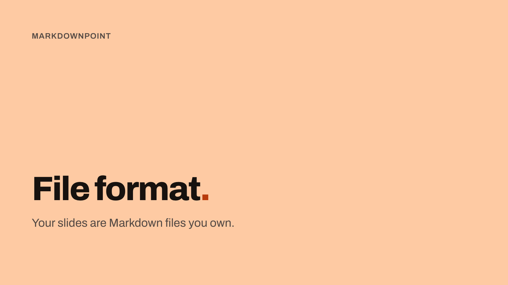

# MarkdownPoint file format

MarkdownPoint is a presentation app for Mac and Windows: [markdownpoint.com](https://markdownpoint.com).

Each presentation is a folder with two main files:

- `slides.md` contains the text, speaker notes, sections, and slide order.
- `presentation.mdpoint` contains the layout, objects, and animation as JSON.

Themes and media are in subfolders. You can edit the presentation in MarkdownPoint, in a text editor, or with an AI agent.

## Write in Obsidian

Write your slide text and speaker notes in Obsidian with the [MarkdownPoint plugin](https://community.obsidian.md/plugins/markdownpoint). You can edit all the slides in one document. Use the outline to add or move slides.

Open the same presentation in MarkdownPoint to work on layout, images, 3D, and animation. Both apps save to the same files. You can switch between them without importing or exporting.

Keep the presentation's whole folder in your vault and open `slides.md` in Obsidian's Live Preview. The [Markdown guide](md-file.md#writing-in-obsidian) explains the workflow.

## Slides and objects

Each slide has an id. Its marker in `slides.md` and its entry in `presentation.mdpoint` use the same id. Text blocks use the ids of their objects. To move a slide, move its whole block in `slides.md`. Its id doesn't change.

Objects use the selected theme's fonts, color schemes, text styles, and layouts. A slide can add objects and override keys of the objects it inherits from its layout.

Text and image objects use a 2D frame for position and size. A 3D model has a position, rotation, and scale. Keyframes animate an object's parameters over time. The [reference](reference/v1.md#objects) lists each key's units, defaults, and allowed values.

## A small presentation



The slide's Markdown is:

```markdown
<!-- slide: title -->

<!-- text: eyebrow -->
MarkdownPoint

<!-- text: title -->
File format==.==

<!-- text: body -->
Your slides are Markdown files you own.

<!-- notes -->
Speaker notes go here. Only the presenter sees them.
```

The [complete presentation](examples/first-deck) includes the theme and JSON file.

## Guides

- **[The .md file](md-file.md)**: write the words, arrange slides, and add speaker notes. Start here when editing a presentation by hand.
- **[The .mdpoint file](mdpoint-file.md)**: place objects, set their keys, and animate them.
- **[Themes](themes.md)**: share fonts, colors, text styles, and layouts across slides.
- **[Reference, version 1](reference/v1.md)**: look up a key's exact meaning, values, units, and defaults.
- **[Agent contract, version 1](agent/1/README.md)**: the methods, requests, and errors coding agents use with the running app.

## Files and folders

```
My talk/
  slides.md              text, notes, sections, and slide order
  presentation.mdpoint   objects, layout, styles, and animation
  media/                 imported images, videos, audio, and models
  generated/             generated images, 3D text models built by a program, and image generation records
  themes/<key>/          master.json, layout files, fonts, and images
  versions/              saved versions, one folder each
```

Media and theme resources use relative paths. Move the whole folder when moving a presentation. Rename the folder to rename the presentation.

MarkdownPoint applies the orientation an image's file states. A JPEG uses the orientation in its first Exif segment that isn't empty. A PNG uses the orientation in an `eXIf` chunk of any size before its image data, if the chunk's CRC is correct. An AVIF is rotated by its `irot` property and then mirrored by its `imir` property. A WebP and every other image are drawn with no orientation applied. A picture's width and height in the presentation are its size after the orientation is applied. A tool that draws a presentation orients each picture by this rule and no other.

When you place a PNG, JPEG, or WebP image with a side longer than 4096 pixels, MarkdownPoint scales it to 4096 pixels on that side and saves it in `media/` in the same file type. The saved picture keeps the original's EXIF and XMP. In them, the size, the orientation, and the color space are set to match the saved pixels. A saved WebP has its pixels in the original's orientation, and the original's orientation tag. The EXIF thumbnail and a JPEG's extended XMP are left out. MarkdownPoint saves an animated PNG or WebP, a picture of more than 268,435,456 pixels, and a file over about 402 MB at full size. Other file types, and files you copy into `media/` yourself, are left as they are.

Keep one `slides.md` and one `presentation.mdpoint` at the folder's root. The two files must have those names in any letter case. The folders `media`, `generated`, `themes`, and `versions` are always lowercase. Mac and Windows disks ignore letter case by default. On such a disk, MarkdownPoint still finds the files in a folder named `Media` or `MEDIA` and warns about it. On a disk that tells capitals apart, those files are missing. The presentation names every other file exactly as its folder lists it. MarkdownPoint won't open a folder that contains duplicate copies, such as `slides 2.md` or a sync service's conflicted copy. Resolve any duplicates before opening the presentation.

A presentation's folder contains one presentation. Except in `versions/`, a folder inside it that contains a `slides.md` and a `presentation.mdpoint` is a presentation of its own and isn't part of the one around it. MarkdownPoint doesn't open or create a presentation inside another presentation's folder.

MarkdownPoint doesn't copy unrelated files in the folder. Symbolic links and aliases aren't supported. Copy the original files into the folder. A file or folder name can't start with a dot, contain `#`, `?`, `/`, `\`, `:`, `*`, `"`, `<`, `>`, or `|`, end in a space or a dot, or be a name Windows reserves, such as `CON`. MarkdownPoint hides a file or folder whose name starts with a dot. It lists a file with one of the other names but can't use it until you rename it.

Files and folders whose names start with `.markdownpoint` belong to MarkdownPoint. They can be in the presentation's folder or next to it. They are never part of the presentation. Each example's `.gitignore` excludes them from git with the line `.markdownpoint*`.

To start a presentation by hand, copy an example's whole folder. The example's theme is in its `themes` folder. `mdpoint presentation create <folder>` creates a new presentation with Basic and opens it if MarkdownPoint is running.

## Saved versions

“File › Save Version…” saves a copy of the slides, text, objects, and settings. The version uses the presentation's media and the theme named in its saved file. Changes to those resources also affect the saved version.

Each version is saved in a folder named with the UTC time it was saved and a four-character suffix, such as `versions/2026-10-30T16.20.05Z-k3pz/`. The folder's name gives the version's time. Version history lists the newest version first. The folder contains copies of `presentation.mdpoint` and `slides.md`, and a `version.json` with the version's number and optional name. When two computers save versions while they aren't syncing, all the versions are kept, even ones saved in the same second or with the same number. MarkdownPoint never opens a version's folder as a presentation of its own. To open a version, open the presentation and choose the version in its Version history.

“Delete Theme” won't remove a theme used by a saved version. “File › Clean Up…” also keeps files that versions use. Deleting a file directly from the Media list removes it even if a version uses it. That version then shows the file as missing.

A folder in `versions/` with a name of any other form, such as a copy of a version's folder made in Finder or File Explorer, isn't a version. Version history doesn't list it, and “Delete Theme” and Clean Up don't keep the theme or files it uses. MarkdownPoint never opens anything under a presentation's `versions/` as a presentation of its own.

While a sync service is still downloading a version, no theme can be deleted and Clean Up deletes nothing.

Include `versions/` in git if you want to keep the saved versions with the presentation.

## Format versions

Every file states its format version, a major and a minor number, in quotes: `"markdownpoint": "1.0"` in JSON and `markdownpoint: "1.0"` in the .md file's frontmatter. The quotes are needed because 1.10 and 1.1 are the same number.

MarkdownPoint 1.x opens any version 1.x file. A later minor version can add data that an earlier reader skips. When MarkdownPoint opens such a file, it shows a notice and keeps the unknown data when it saves. An unknown key, word, or object stays as long as the record or entry that contains it does. A list of values is one exception. A save that changes the list writes the whole list again, and the unknown data in it is lost. In the .md file, an unknown Markdown form stays as written until its block is edited or the file is formatted. It is then written as plain words. If two people duplicate a slide before their copies sync, the unknown data stays in only one of the copies. Saving never lowers the file's version number. A version 2.0 file requires MarkdownPoint 2.

The format is not final. Version 1.0 may still change before release.

## License

[MIT](LICENSE).
