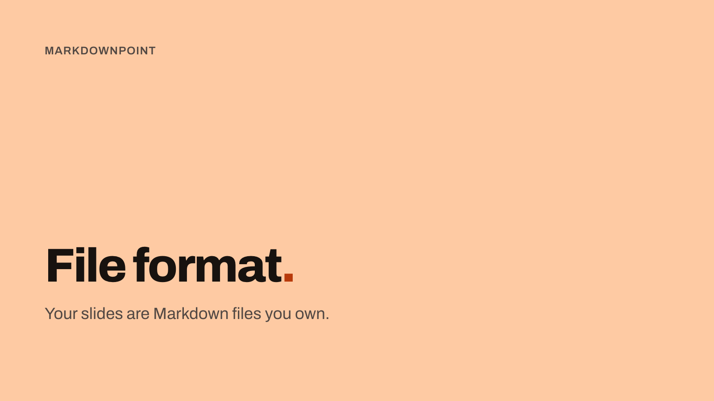
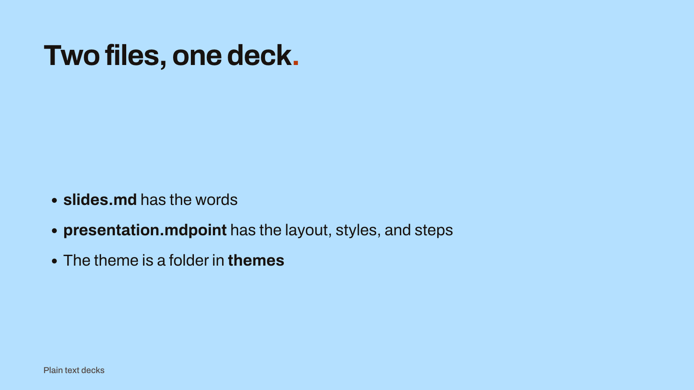
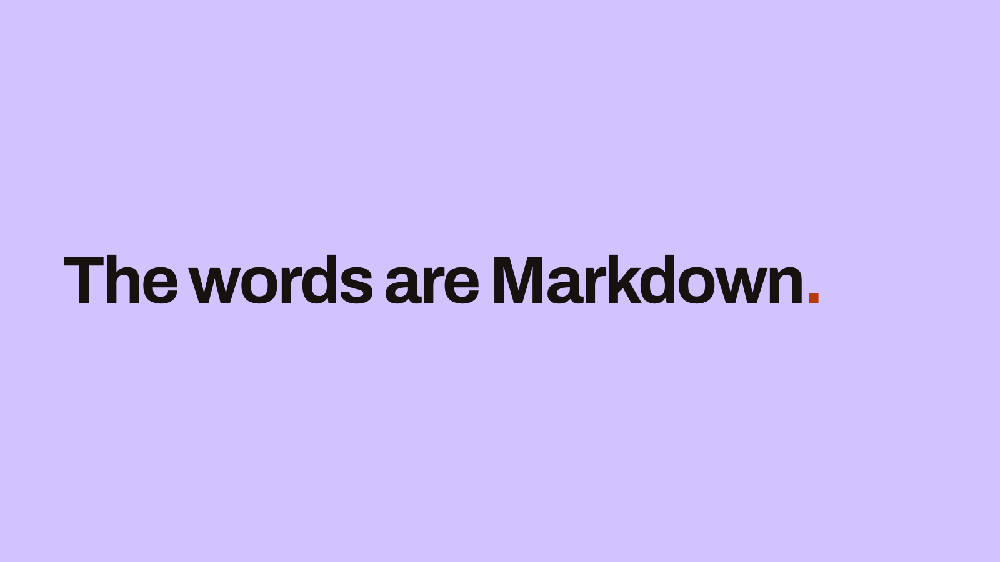
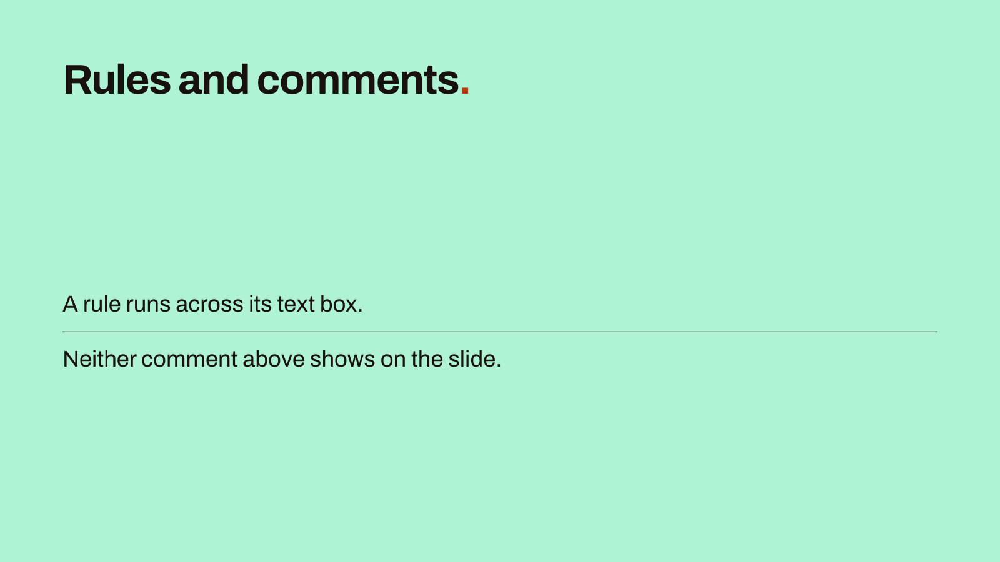
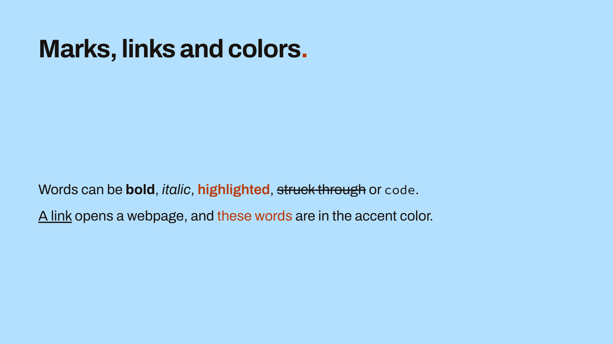
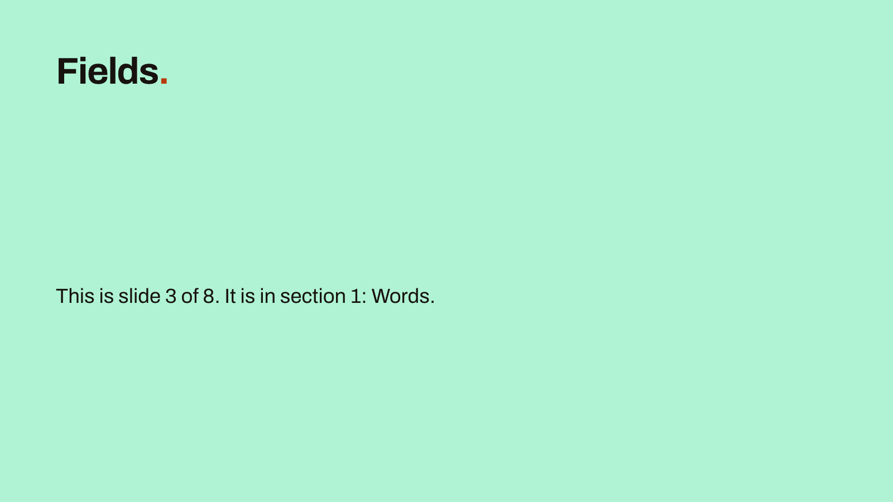
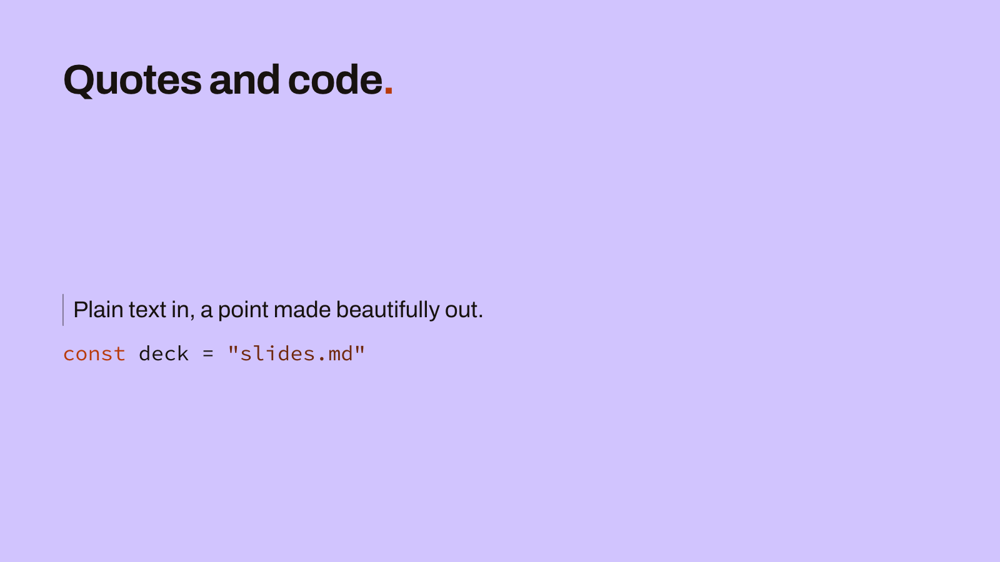
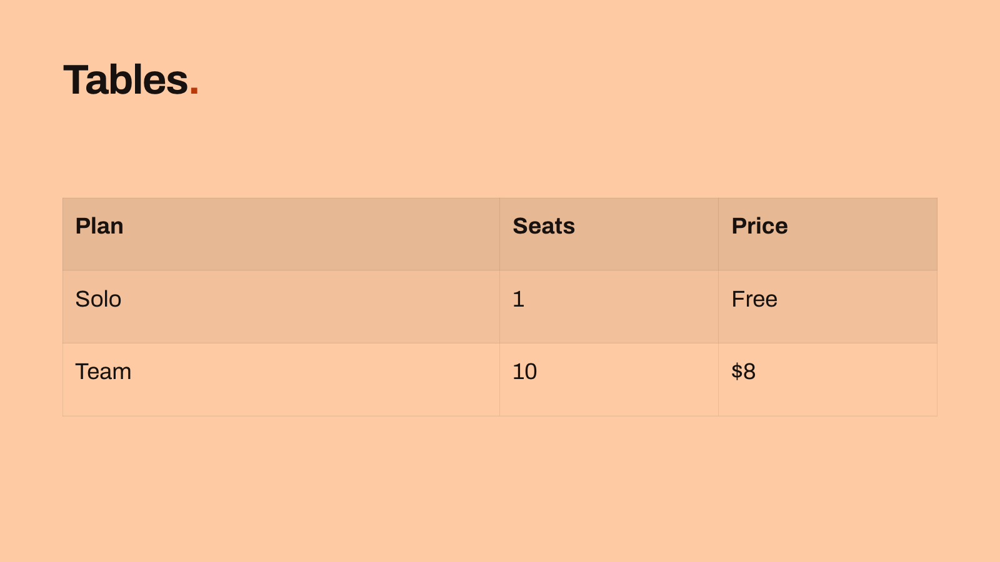

# The .md file

`slides.md` contains the text, speaker notes, sections, and slide order. You can edit it in any text editor. MarkdownPoint watches the folder and shows your saved changes right away.

The objects' positions, styles, and animation are in [the .mdpoint file](mdpoint-file.md). A text block's id matches the id of its object.

This is the whole file of a presentation with three slides:

```markdown
---
markdownpoint: "1.0"
id: 318494ee-4e44-456f-818a-ec761b41fec2
footer: "Plain text decks"
---

<!-- section: start -->
# Start

<!-- slide: title -->

<!-- text: eyebrow -->
MarkdownPoint

<!-- text: title -->
File format==.==

<!-- text: body -->
Your slides are Markdown files you own.

<!-- notes -->
Speaker notes go here. Only the presenter sees them.

<!-- slide: points -->

<!-- text: title -->
Two files, one deck==.==

<!-- text: body -->
- **slides.md** has the words
- **presentation.mdpoint** has the layout, styles and steps
- The theme is a folder in **themes**

<!-- section: finish -->
# Finish

<!-- slide: close -->

<!-- text: body -->
The words are Markdown==.==
```

  

## Writing in Obsidian

Create the presentation in MarkdownPoint, in your Obsidian vault's folder or a folder inside it. Then choose “Open in Obsidian” in the File menu. Obsidian opens the presentation's `slides.md` in that vault. The command is dimmed when the presentation isn't in a vault or Obsidian isn't installed.

Write your slide text and speaker notes in Obsidian with the [MarkdownPoint plugin](https://community.obsidian.md/plugins/markdownpoint). Open `slides.md` in Live Preview to edit all the slides and notes in one document. Use the outline to add or move slides. Use Source mode to edit the Markdown and its markers directly. Keep `presentation.mdpoint`, the themes, and the media next to `slides.md`.

Use the plugin's “Open in MarkdownPoint” command to save the presentation and return to the desktop app. Work on the layout, images, 3D, and animation there. The two apps use the same files throughout.

When you add or delete a slide, the plugin updates both presentation files. When editing the source directly, follow the rules below for changes that affect both files. Use the supported Markdown for slide content. Obsidian wikilinks and note embeds don't become slide content.

## Slide and text markers

Comment markers separate slides and text blocks. Each marker gives the id of its slide or object. A heading or horizontal rule doesn't start a slide.

Each marker is on a line of its own. Any number of spaces or tabs can come before or after it. Between code fences, a line that looks like a marker is code.

The ids in the markers connect the two files. Keep a slide's id when changing its title or moving it. If you change the id, update it in both files.

## Frontmatter

Start the file with frontmatter between two `---` lines. MarkdownPoint uses the following keys. Write each one on a single line as `key: value`:

- `markdownpoint`: the format version in quotes, such as `markdownpoint: "1.0"`.
- `id`: the presentation's lowercase UUID. Use the same value as in the .mdpoint file.
- `footer`: the footer text.
- `save-id`: the id of the save that wrote the files. MarkdownPoint writes it while the presentation is shared for editing. The .mdpoint file has the same id. An older copy of this file with the same words has a different one. Other tools leave it unchanged.

Put `footer` in double quotes if it contains a space followed by `#`. Otherwise the `#` starts a comment. Also quote it if it contains a colon followed by a space, or if it starts with punctuation such as `[`, `*`, or `- `. Without quotes, some of these values aren't text in YAML. MarkdownPoint refuses them. MarkdownPoint always writes the footer in double quotes.

You can add your own keys for information used by your tools or workflow. MarkdownPoint ignores them and saves them as written.

## Sections

`<!-- section: id -->` starts a section. An id uses lowercase letters, digits, and single hyphens. It starts with a letter and ends with a letter or digit, such as `intro` or `q3-numbers`. The next line is a level-1 heading with the section's name: `# Name`. MarkdownPoint removes any formatting from the heading. The heading can't have a comment, not even a paragraph id. A section's block contains nothing else. Sections are optional, but once there is one, every slide must be in a section.

## Slides

`<!-- slide: id -->` starts a slide. Only a marker starts a slide. A slide continues until the next slide, section, or composition marker, or the end of the file. Slides appear in the order they're listed. To move a slide, move its lines. The .mdpoint file doesn't change. In git, a moved slide shows as lines deleted in one place and added in another. Merging the move with an edit to that slide's words gives a conflict over the whole slide.

Each slide also has an entry in [the .mdpoint file](mdpoint-file.md) under the same id. The order of entries there doesn't matter. `layout` is the theme layout the slide uses.

```json
{
  "close": {"layout": "one-liner"},
  "points": {"layout": "content-with-header", "scheme": "sky"},
  "title": {"layout": "title"}
}
```

A new slide needs both its marker and its entry. To delete or rename a slide, change both files.

## Text

`<!-- text: id -->` starts an object's text. The text continues until the next marker. Here `eyebrow`, `title`, and `body` are placeholders from the slide's layout. For any other object, the id is its id in the .mdpoint file. Shapes, tables, and charts get their text the same way.

Paragraphs are separated by one or more blank lines. An empty paragraph is a line with only `<br>`, optionally followed by spaces or tabs, with a blank line before and after it. Two `<br>` lines in a row, with nothing else, are one empty line with a line break. Blank lines right after a marker or before the next marker are only separators. A Markdown formatter can add or remove them without changing the slide. A code block that is never closed runs to the end of the file. Its blank lines are part of its code, except the last one.

## Speaker notes

`<!-- notes -->` starts the slide's speaker notes. Only the presenter sees them. Notes use the same Markdown as slide text and can appear anywhere among the slide's blocks. A paragraph id in speaker notes is read as it is in slide text and is never shown. No step can name it. MarkdownPoint doesn't give ids to paragraphs in notes. It saves notes as written and doesn't warn about a repeated or misspelled id in them.

## Compositions

A composition is a reusable scene, such as a card with an animated counter. `<!-- composition: id -->` starts its block. Use the id of its entry under `compositions` in the .mdpoint file. Compositions don't belong to sections and don't appear as slides. MarkdownPoint adds new compositions after the existing ones, or after the slides if there are none. You can move a composition block elsewhere in the file.

Under the composition's marker, `<!-- text: id -->` starts the words of one of the composition's own objects. A slide uses the same marker. `<!-- control: id -->` starts a text control's default words. Its id is the control's id under `controls` in the .mdpoint file. An instance shows the default words unless it sets its own. It sets them on its slide, under `<!-- text: instance.control -->`, with the instance's id and the control's id:

```markdown
<!-- slide: metrics -->

<!-- text: north.label -->
North

<!-- composition: metric -->

<!-- control: label -->
Label
```

## Horizontal rules

A line of `---` is a horizontal rule. On a slide, it spans its text box. It can appear anywhere in a text or notes block: at the start, between paragraphs, or at the end. A `---` at the end of a slide belongs to the slide's last block.

Leave a blank line above a rule. Directly under a line of text, `---` isn't a rule. It makes that line a heading.

A `---` must be inside a block. Directly under a slide's marker, before its first text or notes marker, it's an error.

## Escapes

To keep a line that looks like a marker inside its block, write a backslash after `<!--`, as in `<!--\ slide: example -->`. MarkdownPoint removes the backslash when it reads the file. The line is then the comment you meant.

This slide has a rule, a comment, and an escaped marker. Neither comment is shown:

```markdown
<!-- slide: rules -->

<!-- text: title -->
Rules and comments==.==

<!-- text: body -->
A rule runs across its text box.

---

<!-- Check these numbers before the talk. -->

<!--\ slide: draft -->

Neither comment above shows on the slide.
```



## Markdown

Text objects, tables, and speaker notes use Markdown. The [reference](reference/v1.md#markdown) lists everything that's supported.

### Marks, links, and colors

```markdown
<!-- slide: marks -->

<!-- text: title -->
Marks, links and colors==.==

<!-- text: body -->
Words can be **bold**, *italic*, ==highlighted==, ~~struck through~~ or `code`.

[A link](https://markdownpoint.com) opens a webpage, and [these words]{color=accent} are in the accent color.
```



`==highlighted==` and `[colored]{color=accent}` text are MarkdownPoint additions. A color is either a role from the slide's color scheme, such as `accent`, or a hex color: `[text]{color="#2F7D4F"}`.

Words can also have their own weight: `[text]{font-weight=600}`. The weight is 300, 400, 500, 600, 700, or 900. To set both a color and a weight, use one span: `[text]{color=accent font-weight=600}`. The two can come in either order, and each value can be bare or quoted. MarkdownPoint writes the color first. A span with any other key, a repeated key, or a value its key doesn't accept stays as written, and none of it applies, not even its color. `**Bold**` overrides a word's own weight, and a word's own weight overrides the weight a text style gives to italic or highlighted words.

Code can have a color and a link, but no other mark. Bold, italic, highlight, strikethrough, and a weight don't apply to code. MarkdownPoint writes such a mark only around the words next to the code: `` **slides are `code` you** `` becomes `` **slides are** `code` **you** ``.

### Lists

```markdown
<!-- slide: lists -->

<!-- text: title -->
Lists==.==

<!-- text: body -->
- A bullet
  - A deeper bullet
- Another bullet

1. First
2. Second
```


To nest an item under the one above, indent it to where that item's text starts: two spaces under `- `, three under `1. `. A numbered list can start at any number with up to nine digits.

An empty item contains `<br>`: `- <br>`. An empty item with a list nested under it is just its marker. With a `<br>` line there, GitHub and other apps that read CommonMark would include the nested list in that line. A nested numbered list that starts at a number other than 1 needs a blank line before it.

To start another list immediately after one, change the list marker. MarkdownPoint uses `*` after `-`, or `1)` after `1.`.

### Fields

```markdown
<!-- slide: fields -->

<!-- text: title -->
Fields==.==

<!-- text: body -->
This is slide {{slide-number}} of {{slide-count}}, in section {{section-number}}, {{section-name}}.
```



A field shows a value that MarkdownPoint fills in, such as the slide number. The [reference](reference/v1.md#markdown) lists every field and how it counts. Slide numbers count only the slides that are shown. With slides A, B, and C, and B skipped, `{{slide-number}} of {{slide-count}}` on C shows 2 of 2. The `footer` field shows the footer set in the frontmatter.

### Quotes and inline code

````markdown
<!-- slide: quote -->

<!-- text: title -->
Quotes and code==.==

<!-- text: body -->
> Plain text in, a point made beautifully out.

```js
const deck = "slides.md"
```
````



### Tables

A table is its own object, written as a Markdown table.

```markdown
<!-- slide: table -->

<!-- text: title -->
Tables==.==

<!-- text: prices -->
| Plan | Seats | Price |
| --- | --- | --- |
| Solo | 1 | Free |
| Team | 10 | $8 |
```

Its position, columns, row heights, and style are in the .mdpoint file. A row grows taller when its words need more room. The table is as tall as its rows:

```json
[
  {
    "id": "prices",
    "type": "table",
    "frame": {"x": 120, "y": 380},
    "inset": 24,
    "text-style": "body",
    "column-widths": [840, 420, 420],
    "min-row-heights": [140, 140, 140],
    "alternating-fills": true
  }
]
```



### Code blocks

A code block is written between two fences. A fence is three or more backticks or tildes. The closing fence uses the same character and is at least as long. The language named after the opening fence sets how the code is colored. The name can be in any case, and `js` works as well as `javascript`. The [reference](reference/v1.md#markdown) lists every name. Add `{lines:true}` after the language to number the lines.

### Characters

A character reference is read as the character it names. `&amp;` is `&`, and `&copy;` and `&#169;` are both `©`. In code, a reference shows as written. Anywhere else, put a backslash before the `&` to keep the reference as written: `\&amp;`. MarkdownPoint writes that backslash when you type a reference in the app.

In a list item, a tab is read as spaces. MarkdownPoint writes a tab there as `&#9;`. A tab or four spaces at the start of a paragraph would start a code block, and spaces after a list item's marker would belong to the marker. In those places, MarkdownPoint writes the first tab or space as `&#9;` or `&#32;`.

### Where it differs from CommonMark

Bold and italic follow CommonMark, with one difference. In CommonMark, a run of `*` between punctuation and a letter can open toward the letter but can't close. In MarkdownPoint, such a run can both open and close. So `**C++**17` is read as a bold “C++” followed by “17”, and `**Note:**This` as a bold “Note:” followed by “This”. In CommonMark, the asterisks in both stay as written.

The same rule applies to Chinese and Japanese. Both are written without spaces between words. In `これは**「重要」**です`, “「重要」” is bold. This matches the [CJK-friendly amendment](https://github.com/tats-u/markdown-cjk-friendly) to CommonMark.

The rule changes how one rare case is read. `*(*foo*)*` is read as italic parentheses around a plain “foo”. In CommonMark, it is one italic inside another. A run of `_` is read as in CommonMark.

The style can change anywhere in a word. `**Mark**down` is read back as a bold “Mark” followed by “down”. When asterisks inside one word can't express the changes, MarkdownPoint puts each run in a span with no attributes. A word that is bold, then bold italic, then italic is written `[**Mark**]{}[***do***]{}[*wn*]{}`. A span with no attributes adds no formatting of its own.

### Unsupported Markdown

Images, HTML tags, and footnotes are kept in the file as written. The slide shows them as plain text. Only `<br>` has an effect: it adds a line break in a text block. To put an image on a slide, add an image object in [the .mdpoint file](mdpoint-file.md).

An HTML comment inside a text or notes block is a note to yourself. It's kept in the file and never shown. A comment at the end of a slide belongs to the slide's last block. A table's or a chart's block contains only its table. A comment can't follow it.

One kind of comment isn't a note: a paragraph id, described in the next section.

### Paragraph ids

To bring a paragraph in on a click, a step in [the .mdpoint file](mdpoint-file.md) names the paragraph by its id. The id is a comment at the end of the paragraph's last line, as in `Our results <!-- id: k3x9a2 -->`. Headings and list items get an id the same way. An id follows the same rules as a section's id: lowercase letters, digits, and single hyphens, starting with a letter and ending with a letter or digit. Spaces and tabs around the comment and inside it don't matter. MarkdownPoint writes the comment after one space, as shown.

MarkdownPoint writes the ids. When a paragraph is split, the first part keeps its id and the second part is a new paragraph. When two paragraphs are joined, the joined paragraph keeps the first one's id. Do the same when you edit the words by hand. When a merge joins two versions of a paragraph with the id at the end of each, MarkdownPoint reads one id. It writes the id once the next time you edit that text block or run `mdpoint format`. Keep each id at the end of its paragraph, and don't give a new paragraph an id. MarkdownPoint gives it one.

Each id belongs to one paragraph of its text. A copied line or a merge can leave two paragraphs with the same id. The first keeps it, and the later one is read as a new paragraph. MarkdownPoint warns about this and names the line. When it saves that text, it writes the later paragraph without the id. It also warns about a comment that looks like a misspelled id, such as `<!-- ID: k3x9a2 -->`, `<!-- id k3x9a2 -->`, or an id alone on its line. Each of these is read as a note.

## Editing by hand

MarkdownPoint can't read the file if it contains any of these, among other problems:

- text, a comment, or a `---` outside a text or notes block
- a comment after a table, or after a chart's table
- a marker written incorrectly, such as `<!-- Slide: intro -->`, or the same marker twice
- a section without its `# Name` line
- `markdownpoint` without quotes, or with a major version other than 1
- a slide marker without its entry in the .mdpoint file, or an entry without its marker
- a code block that is never closed and contains a marker
- a merge conflict that git left outside a code block, from its `<<<<<<<` line to its `>>>>>>>` line
- one of MarkdownPoint's own frontmatter keys not written as `key: value` on one line

A comment line counts as an incorrectly written marker when it contains a marker's word and at most one other word, in any letter case. A closing slash, or words after `-->`, don't change this.

MarkdownPoint then shows the file, the line, and the problem, and it won't open the presentation. If the presentation is already open, MarkdownPoint waits for the fix and never overwrites your file.

Inside a code block, a merge conflict's lines are part of the code. A slide can show them. A real conflict there stays on the slide until you resolve it.

A layout's placeholder keeps its id. Renaming it in MarkdownPoint changes only its label. The slides' text blocks and overrides stay the same. If you change a placeholder's id by hand in the layout file, also change the text blocks and overrides of every slide that uses that layout to the new id. MarkdownPoint doesn't show a block that names no object, and warns about it.

A table's column widths and row heights in the .mdpoint file are listed in the table's order. When you add or remove a column or a row by hand, add or remove its width or height at the same position. MarkdownPoint warns when a table has more widths or heights than columns or rows.

## Validating the files

`mdpoint` validates a presentation folder without the app running. It reports file errors, including missing images, models, and fonts.

To install it, open MarkdownPoint's Settings, choose “Coding agents”, and click “Install” under “Command line”. Run `mdpoint validate` in the presentation folder. For JSON output, run `mdpoint --presentation <folder> --json validate`.

Each issue has a `severity` of `error` or `warning`, a `code`, and a `message`. Most issues also have a `path`. For `presentation.mdpoint`, the path is its chain of keys, such as `slides.intro.objects.title.opacity`. For `slides.md`, it is the frontmatter key or the section, such as `frontmatter.footer` or `sections.intro`. For a missing or unreadable file, it is the file's own path. The `disposition` describes how MarkdownPoint handles the problem: `show-presentation`, `skip-object`, `refuse-slide`, or `refuse-presentation`. The command exits with status 1 if any issue is an error.

## Saving and formatting

Saving preserves the formatting of unchanged frontmatter, slides, and text blocks. Edited parts are written in MarkdownPoint's standard Markdown. Run `mdpoint format` to reformat both presentation files.
