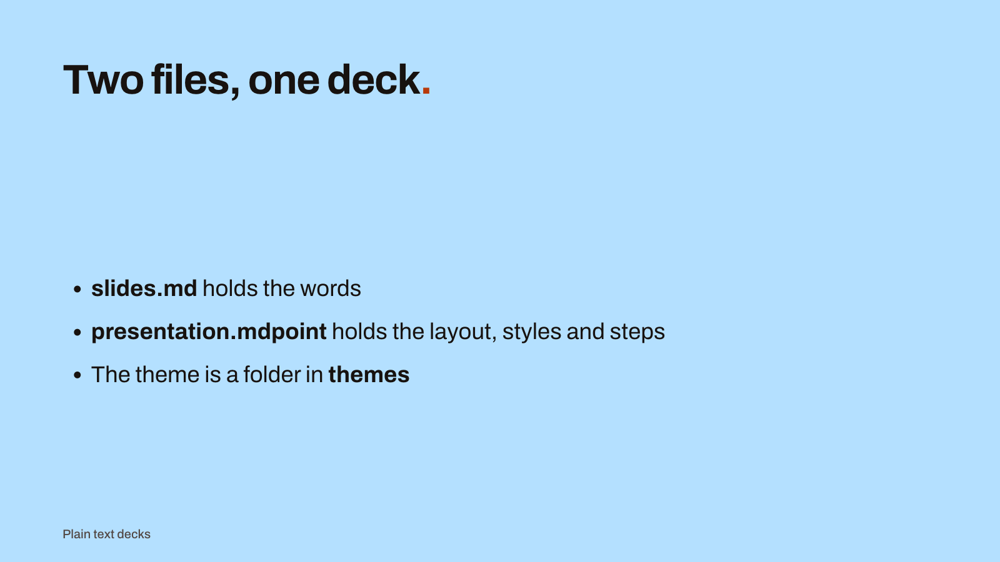
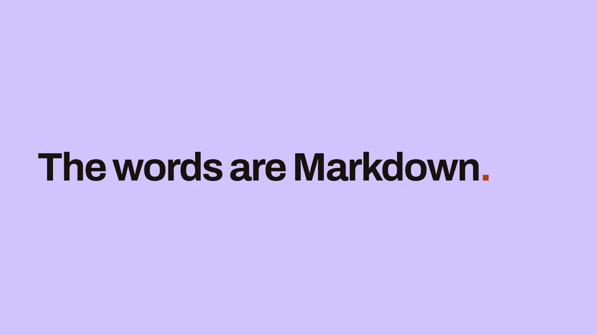
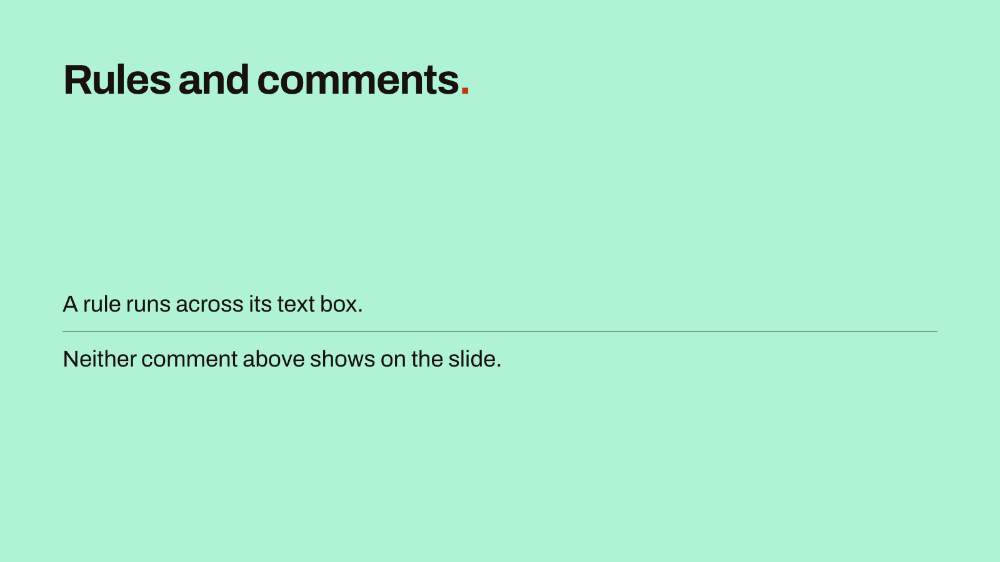
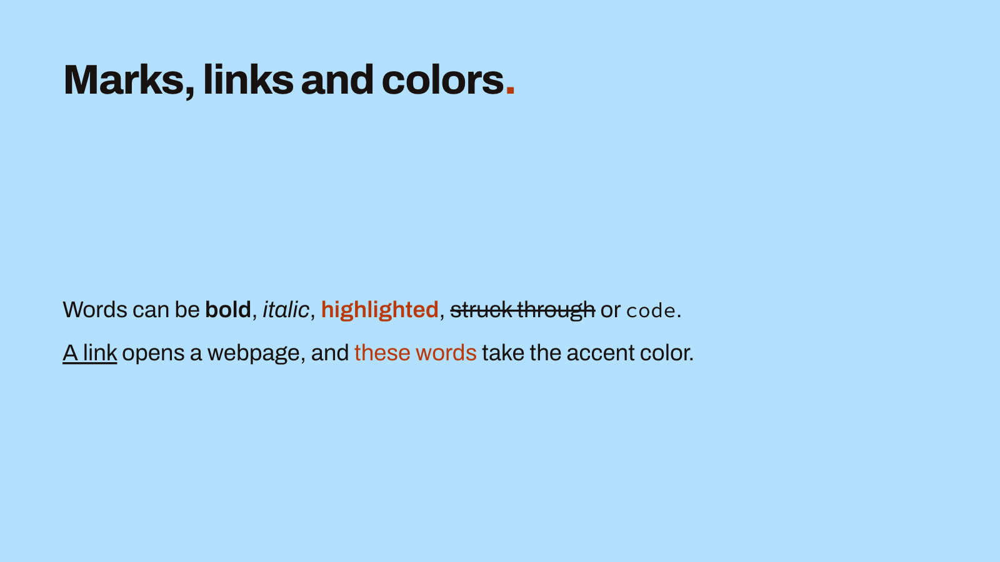
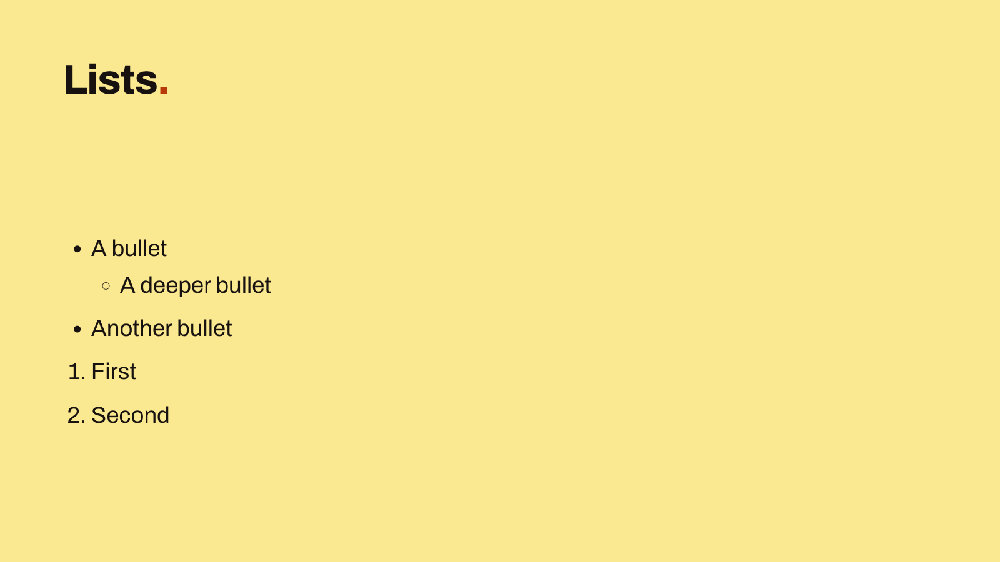
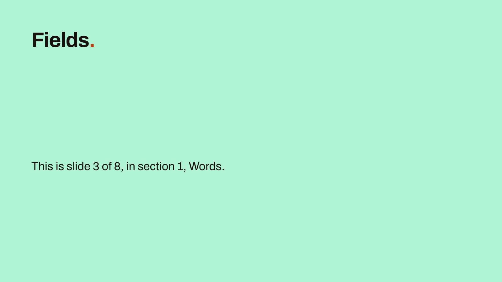
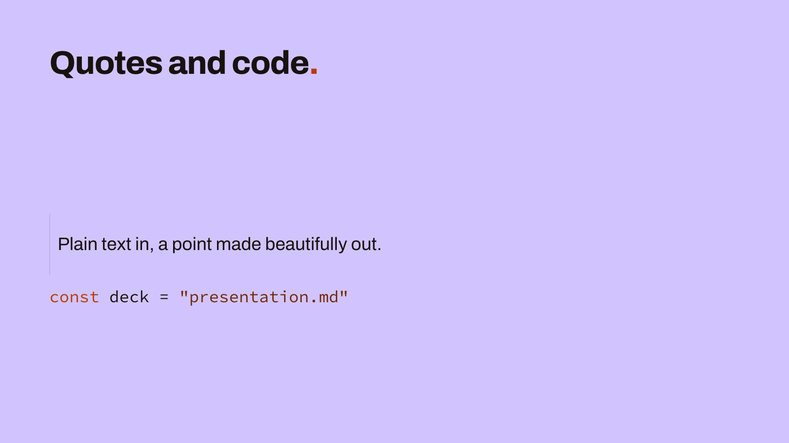
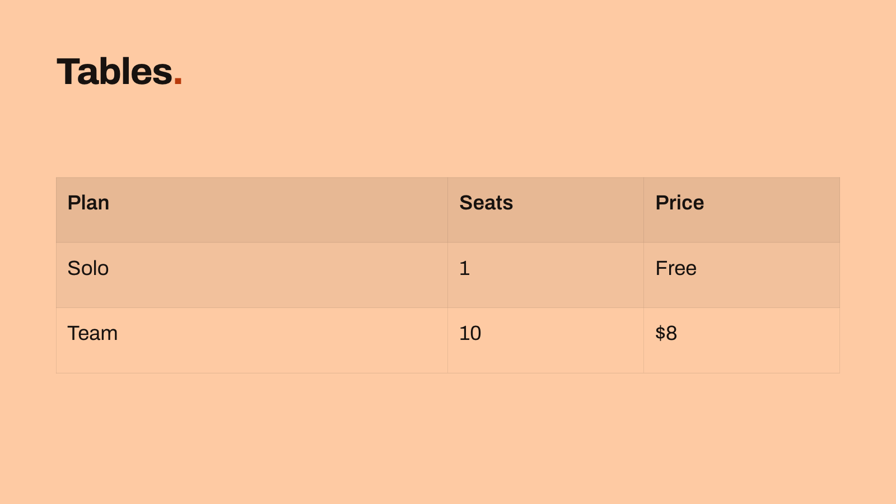

# The .md file

`slides.md` holds the words, speaker notes, sections and slide order. You can edit it in any text editor. MarkdownPoint watches the folder and shows your saved changes right away.

The objects' positions, styles and motion are in [the .mdpoint file](mdpoint-file.md). A text block's ID matches the ID of its object.

This is the whole file of a presentation with three slides:

```markdown
---
markdownpoint: "1.0"
id: 318494ee-4e44-456f-818a-ec761b41fec2
footer: "Plain text decks"
---

<!-- section: start -->
# Start

<!-- slide: title -->

<!-- text: eyebrow -->
MarkdownPoint

<!-- text: title -->
File format==.==

<!-- text: body -->
Your slides are Markdown files you own.

<!-- notes -->
Speaker notes go here. Only the presenter sees them.

<!-- slide: points -->

<!-- text: title -->
Two files, one deck==.==

<!-- text: body -->
- **slides.md** holds the words
- **presentation.mdpoint** holds the layout, styles and steps
- The theme is a folder in **themes**

<!-- section: finish -->
# Finish

<!-- slide: close -->

<!-- text: body -->
The words are Markdown==.==
```

  

## Writing in Obsidian

Create the presentation in MarkdownPoint, in your Obsidian vault's folder or a folder inside it. Then choose “Open in Obsidian” in the File menu. Obsidian opens the presentation's `slides.md` in that vault. The command is dimmed for a presentation outside a vault, and when Obsidian isn't installed.

Write your slide text and speaker notes in Obsidian with the [MarkdownPoint plugin](https://community.obsidian.md/plugins/markdownpoint). Open `slides.md` in Live Preview to edit all the slides and notes in one document. Use the outline to add or move slides. Use Source mode to edit the Markdown and its markers directly. Keep `presentation.mdpoint`, the themes and the media beside `slides.md`.

Use the plugin's “Open in MarkdownPoint” command to save the presentation and return to the desktop app. Work on the layout, images, 3D and animation there. The two apps use the same files throughout.

When you add or delete a slide, the plugin updates both presentation files. When editing the source directly, follow the rules below for changes that affect both files. Use the supported Markdown for slide content. Obsidian wikilinks and note embeds do not become slide content.

## Slide and text markers

Comment markers separate slides and text blocks. Each marker gives the ID of its slide or object. A heading or horizontal rule does not start a slide.

The IDs in the markers connect the two files. Keep a slide's ID when changing its title or moving it. If you change the ID, update it in both files.

## Frontmatter

Start the file with frontmatter between two `---` lines. MarkdownPoint uses the following keys. Write them on single lines as `key: value`:

- `markdownpoint`: the format version in quotes, such as `markdownpoint: "1.0"`.
- `id`: the presentation's lowercase UUID. Use the same value as in the .mdpoint file.
- `footer`: the footer text.
- `save`: written by MarkdownPoint during shared-folder editing. Leave this value unchanged.

Put `footer` in double quotes if it contains a space followed by `#`; otherwise, the `#` starts a comment. MarkdownPoint always writes the footer in double quotes.

You can add your own keys for information used by your tools or workflow. MarkdownPoint keeps them as written and ignores them.

## Sections

`<!-- section: id -->` starts a section. An id is lowercase letters, digits and single hyphens, and starts with a letter: `intro`, `q3-numbers`. Under the marker goes one line, `# Name`: a level-1 heading with the section's name. MarkdownPoint drops any formatting in it. Nothing else goes in a section's block. Sections are optional. Once there is one, every slide must be in a section.

## Slides

`<!-- slide: id -->` starts a slide. Only a marker starts one. A slide runs to the next slide, section or composition marker, or to the end of the file. Slides appear in the order they're listed. To move a slide, move its lines.

Each slide also has an entry in [the .mdpoint file](mdpoint-file.md) under the same id. The order of entries there doesn't matter. `layout` is the theme layout the slide uses.

```json
{
  "close": {"layout": "one-liner"},
  "points": {"layout": "content-with-header", "scheme": "sky"},
  "title": {"layout": "title"}
}
```

A new slide needs both its marker and its entry. To delete or rename a slide, change both files.

## Text

`<!-- text: id -->` starts an object's text. It runs to the next marker. Here `eyebrow`, `title` and `body` are placeholders from the slide's layout. For any other object, the id is its id in the .mdpoint file. A shape, a table or a chart takes its text the same way.

One blank line separates paragraphs. Additional blank lines create empty paragraphs on the slide. A blank line immediately after the text marker also creates an empty paragraph. One blank line before the next marker is only a separator.

## Speaker notes

`<!-- notes -->` starts the slide's speaker notes. Only the presenter sees them. Notes use the same Markdown as slide text and can appear anywhere among the slide's blocks.

## Compositions

A composition is a reusable scene, such as a card with an animated counter. `<!-- composition: id -->` starts its block. Use the ID of its entry under `compositions` in the .mdpoint file. Compositions do not belong to sections or appear as slides. MarkdownPoint adds new compositions after the existing ones, or after the slides if there are none. You can move a composition block elsewhere in the file.

Under the marker, `<!-- text: id -->` holds the words of one of the composition's own objects, as on a slide. `<!-- control: name -->` holds a text control's default words, which an instance shows when it sets none. An instance sets its own on the slide that holds it, under `<!-- text: instance.control -->`, with the instance's id and the control's name:

```markdown
<!-- slide: metrics -->

<!-- text: north.label -->
North

<!-- composition: metric -->

<!-- control: label -->
Label
```

## Horizontal rules

A line of `---` is a horizontal rule. On a slide, it runs across its text box. It can stand anywhere in a text or notes block: first, between paragraphs or last. A `---` at the end of a slide belongs to the slide's last block.

Leave a blank line above a rule. Right under a line of text, `---` makes that line a heading instead.

A `---` has to stand in a block. Right under a slide's marker, before its first text or notes marker, it's an error.

## Escapes

A line that looks like a marker needs a change to stay in its block. Write a backslash after `<!--`, as `<!--\ slide: example -->`. MarkdownPoint removes the backslash when it reads the file. The line then shows as the comment you meant.

This slide has a rule, a comment and an escaped marker. Neither comment shows:

```markdown
<!-- slide: rules -->

<!-- text: title -->
Rules and comments==.==

<!-- text: body -->
A rule runs across its text box.

---

<!-- Check these numbers before the talk. -->

<!--\ slide: draft -->

Neither comment above shows on the slide.
```



## Markdown

Text objects, tables and speaker notes use Markdown. The [reference](reference/v1.md#markdown) lists everything that's supported.

### Marks, links and colors

```markdown
<!-- slide: marks -->

<!-- text: title -->
Marks, links and colors==.==

<!-- text: body -->
Words can be **bold**, *italic*, ==highlighted==, ~~struck through~~ or `code`.

[A link](https://markdownpoint.com) opens a webpage, and [these words]{color=accent} take the accent color.
```



`==highlighted==` and `[colored]{color=accent}` text are MarkdownPoint additions. A color is either a role from the slide's color scheme, such as `accent`, or a hex color: `[text]{color="#2F7D4F"}`.

Words can also have a weight of their own: `[text]{font-weight=600}`, one of 300, 400, 500, 600, 700 or 900. With a color it's one span, `[text]{color=accent font-weight=600}`. The two come in either order, each value bare or quoted. MarkdownPoint writes color first. A span with another key, a key twice, or a value its key doesn't take stays as written, and none of it applies, not even its color. `**Bold**` draws over a word's own weight, and a word's own weight draws over the weight a text style gives italic or highlighted words. Code takes no weight of its own.

### Lists

```markdown
<!-- slide: lists -->

<!-- text: title -->
Lists==.==

<!-- text: body -->
- A bullet
  - A deeper bullet
- Another bullet

1. First
2. Second
```



Indent an item to nest it under the one above, as far as the text after that item's marker: two spaces under `- `, three under `1. `. A numbered list can start at any number of up to nine digits.

To start another list immediately after one, change the list marker. MarkdownPoint uses `*` after `-`, or `1)` after `1.`.

### Fields

```markdown
<!-- slide: fields -->

<!-- text: title -->
Fields==.==

<!-- text: body -->
This is slide {{slide-number}} of {{slide-count}}, in section {{section-number}}, {{section-name}}.
```



A field shows a value MarkdownPoint fills in, such as the slide number. The [reference](reference/v1.md#markdown) lists every field. The `footer` field shows the footer set in the frontmatter.

### Quotes and inline code

````markdown
<!-- slide: quote -->

<!-- text: title -->
Quotes and code==.==

<!-- text: body -->
> Plain text in, a point made beautifully out.

```js
const deck = "slides.md"
```
````



### Tables

A table is its own object, written as a Markdown table.

```markdown
<!-- slide: table -->

<!-- text: title -->
Tables==.==

<!-- text: prices -->
| Plan | Seats | Price |
| --- | --- | --- |
| Solo | 1 | Free |
| Team | 10 | $8 |
```

Its position, columns, row heights and style are in the .mdpoint file. A row is taller when its words need it. The table is as tall as its rows:

```json
[
  {
    "id": "prices",
    "type": "table",
    "frame": {"x": 120, "y": 380, "width": 1680},
    "inset": 24,
    "text-style": "body",
    "columns": [840, 420, 420],
    "rows": [140, 140, 140],
    "alternating-fills": true
  }
]
```



### Code blocks

A code block sits between two fences. A fence is three or more backticks or tildes. The closing fence uses the same character and is at least as long. The language after the opening fence colors the code. Its name can be in any case. `js` works as well as `javascript`. The [reference](reference/v1.md#markdown) lists every name. `{lines:true}` after the language numbers the lines.

### Characters

A character reference reads as the character it names. `&amp;` is `&`, and `&copy;` and `&#169;` are both `©`. Code shows it as written. Anywhere else, a backslash before the `&` keeps it as written: `\&amp;`. MarkdownPoint writes that backslash when you type a reference in the app.

A list item reads a tab as spaces, so MarkdownPoint writes a tab there as `&#9;`. A tab or four spaces at the start of a paragraph would start a code block, and spaces after a list item's marker would belong to the marker. There MarkdownPoint writes the first of them as `&#9;` or `&#32;`.

### Where it differs from CommonMark

Bold and italic follow CommonMark, with one difference. CommonMark lets a run of `*` between punctuation and a letter open toward the letter but never close. MarkdownPoint lets such a run both open and close. So `**C++**17` reads as bold “C++” before “17”. `**Note:**This` reads as bold “Note:” before “This”. CommonMark shows the stars in both as written.

The same rule covers Chinese and Japanese, which run without spaces. `これは**「重要」**です` reads as bold “「重要」”. This matches the [CJK-friendly amendment](https://github.com/tats-u/markdown-cjk-friendly) to CommonMark.

The rule changes one rare spelling. `*(*foo*)*` reads as italic parentheses around a plain “foo”, where CommonMark nests one italic inside the other. A run of `_` keeps CommonMark's reading.

A word can change style anywhere. `**Mark**down` reads back as a bold “Mark” before “down”. Where asterisks inside one word can't spell the changes, MarkdownPoint writes each run that changes in a group: a span with no attributes. Bold, then bold italic, then italic inside one word is written `[**Mark**]{}[***do***]{}[*wn*]{}`. A group's words take nothing of their own.

### Unsupported Markdown

Images, HTML tags and footnotes are kept in the file as written. The slide shows them as plain text. Only `<br>` does something: it breaks the line in a text block. To put an image on a slide, add an image object in [the .mdpoint file](mdpoint-file.md).

An HTML comment inside a text or notes block is a note to yourself. It's kept in the file and never shown. A comment at the end of a slide belongs to the slide's last block. A table's or a chart's block holds only its table. A comment can't follow it.

One comment is not a note: `<!-- id: k3x9a2 -->` after a space at the end of a heading's, a paragraph's or a list item's last line is that block's id. A step in [the .mdpoint file](mdpoint-file.md) names a paragraph by its id to bring it in on a click. MarkdownPoint writes the ids. When you edit the words, keep each id at the end of its paragraph, and give a new paragraph none: MarkdownPoint gives it one.

## Editing by hand

MarkdownPoint can't read the file if it has one of these, among others:

- text, a comment or a `---` outside a text or notes block
- a comment after a table, or after a chart's table
- a marker written wrong, such as `<!-- Slide: intro -->`, or the same marker twice
- a section without its one `# Name` line
- `markdownpoint` without quotes, or a version of another major than 1
- a slide marker without its entry in the .mdpoint file, or an entry without its marker
- a code block that takes in a marker and never closes
- a merge conflict that git left outside a code block, from its `<<<<<<<` line to its `>>>>>>>` line
- one of MarkdownPoint's own frontmatter keys not written as `key: value` on one line

A comment line is a marker written wrong when it holds a marker's word and at most one more word. Capitals don't matter. A closing slash and words after `-->` don't change it.

MarkdownPoint then shows the file, the line and the problem. It won't open the presentation. If it's already open, MarkdownPoint waits for the fix and never overwrites your file.

Inside a code block, a merge conflict is the code's words, so a slide can show one. A real conflict there shows on the slide until you resolve it.

A layout's placeholder keeps its id. Giving it a name in MarkdownPoint changes only its label, so no slide's text blocks or overrides change. If you change a placeholder's id by hand in the layout file, change the text blocks and overrides of every slide on that layout to the new id too. MarkdownPoint warns about a block whose name no object has, and doesn't show it.

A table's column widths and row heights in the .mdpoint file follow the table's order. When you add or remove a column or a row by hand, add or remove its width or height at the same place. MarkdownPoint warns when a table has more widths or heights than columns or rows.

## Checking the files

`mdpoint` checks a presentation folder without running the app. It reports file errors, including missing images, models and fonts.

To install it, open MarkdownPoint's Settings, choose “Coding agents” and click “Install” under “Command line”. Run `mdpoint validate` in the presentation folder. For JSON output, run `mdpoint --presentation <folder> --json validate`.

Each issue includes a `severity` of `error` or `warning`, a `code` and a `message`. Most include the affected key's `path`. The `disposition` describes how MarkdownPoint handles the problem: `fallback`, `skip-object`, `refuse-slide` or `refuse-document`. The command exits with status 1 if any issue is an error.

## Saving and formatting

Saves preserve the formatting of unchanged frontmatter, slides and text blocks. Edited parts use MarkdownPoint's standard Markdown. Run `mdpoint format` to reformat both presentation files.
