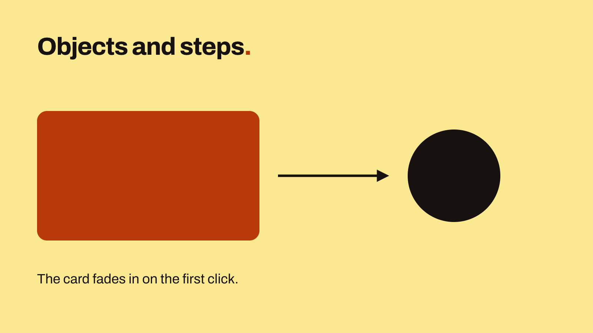
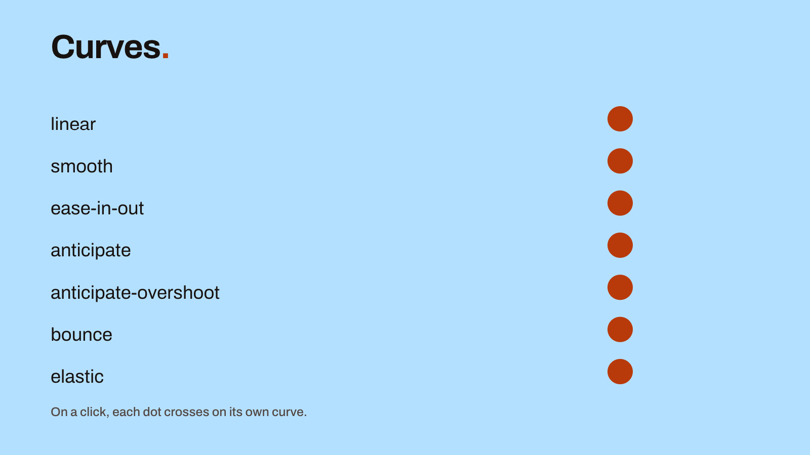
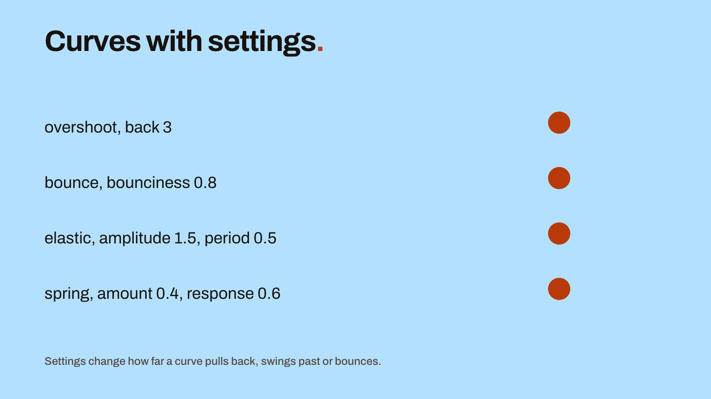
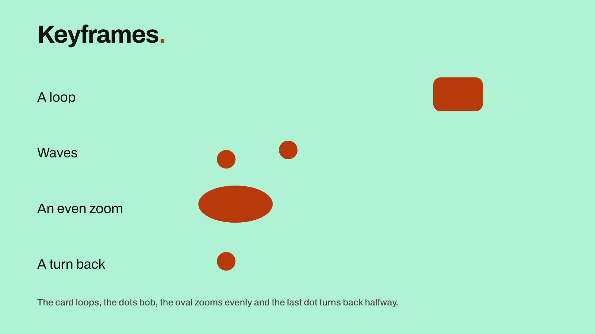
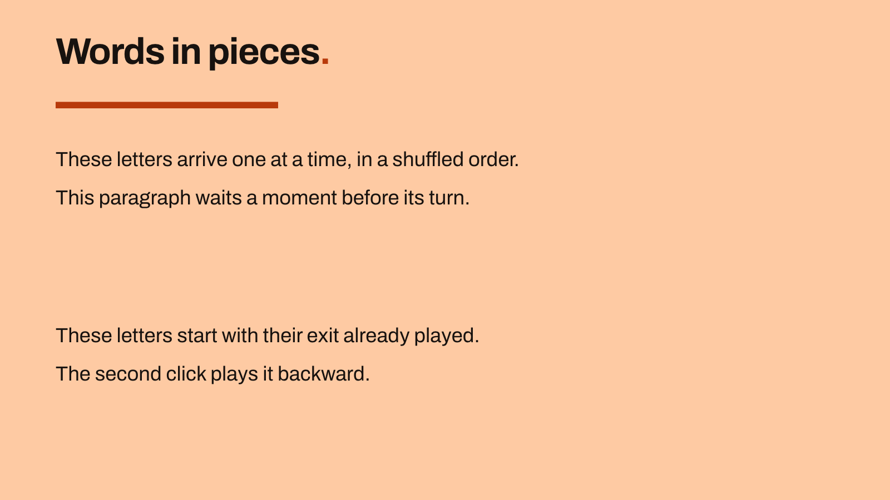
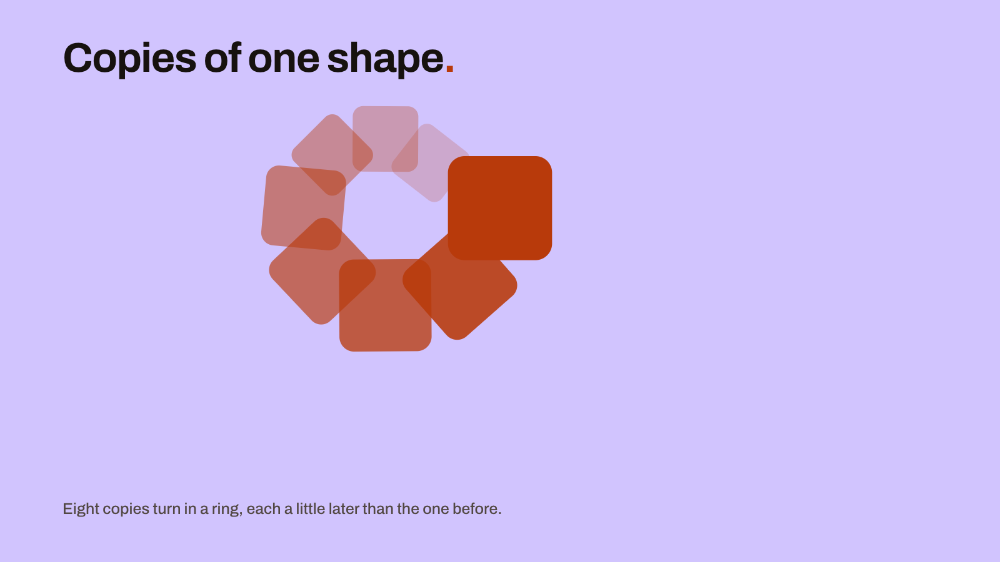

# The .mdpoint file

`presentation.mdpoint` is JSON. It selects the theme and records each slide's layout, objects, properties and motion. The presentation's text and slide order are in [slides.md](md-file.md).

The presentation's name is its folder's. Rename the folder to rename the presentation.



This slide's text is in the .md file:

```markdown
<!-- slide: shapes -->

<!-- text: heading -->
Objects and steps==.==

<!-- text: caption -->
The card fades in on the first click.

<!-- notes -->
Two texts, two shapes and a line with an arrow, drawn on the Blank layout. One step fades the card in.
```

The slide's objects and motion are in the .mdpoint file:

```json
{
  "markdownpoint": "1.0",
  "kind": "presentation",
  "id": "64ea077f-d2ca-4f8c-9015-61feb4de5cb8",
  "theme": "basic",
  "slides": {
    "shapes": {
      "layout": "blank",
      "scheme": "butter",
      "objects": [
        {
          "id": "heading",
          "type": "text",
          "frame": {"x": 120, "y": 110, "width": 1680, "height": 150},
          "text-style": "title"
        },
        {
          "id": "card",
          "type": "shape",
          "shape": "rectangle",
          "frame": {"x": 120, "y": 360, "width": 720, "height": 420},
          "corner-radius": 32
        },
        {
          "id": "dot",
          "type": "shape",
          "shape": "ellipse",
          "frame": {"x": 1320, "y": 420, "width": 300, "height": 300},
          "fill": "text"
        },
        {
          "id": "arrow",
          "type": "line",
          "start": {"x": 900, "y": 570},
          "end": {"x": 1260, "y": 570},
          "cap-end": "arrow",
          "stroke-weight": 8
        },
        {
          "id": "caption",
          "type": "text",
          "frame": {"x": 120, "y": 860, "width": 1680, "height": 80},
          "text-style": "body"
        }
      ],
      "initial": {"card.opacity": 0},
      "steps": [
        {
          "id": "fade-in",
          "name": "Fade in the card",
          "duration": 0.6,
          "curves": {
            "card.opacity": [
              {"id": "card-shows", "time": 0.6, "value": 1, "interpolation": "ease-out"}
            ]
          }
        }
      ]
    }
  }
}
```

Saved JSON uses one line per object property, with blank lines between objects and overrides. The examples on this page use a more compact layout.

Saves preserve formatting in unchanged parts of the file. Edited parts use MarkdownPoint's standard format: a fixed key order, omitted defaults and most numbers rounded to six decimal places. Text-only saves leave the .mdpoint file unchanged. Run `mdpoint format` to reformat both files.

## Slides

The keys in `slides` match the slide IDs in the .md file. The Markdown file sets their order. `layout` selects a layout from the theme. `scheme` selects a color scheme; if omitted, the slide uses its layout's scheme. MarkdownPoint omits a scheme or override value that equals the inherited value. The slide then follows changes to that value in the theme.

## Objects

`objects` lists the slide's objects from back to front. Each has an `id` and a `type`. `frame` is its position and size in canvas units, from the slide's top left. A canvas unit is one pixel of the slide at full size. The theme sets that size: 1920 by 1080 here.

Text for a text object or shape goes in the .md file under `<!-- text: id -->`. Use the object's ID in the marker.

The dot's fill, `text`, is a role in the slide's color scheme, so the dot changes color with the scheme. A hex color such as `"#FA7B26"` stays the same in every scheme.

Omitted keys use their defaults. The card has no fill specified and uses `accent`, the default for shapes. The [object reference](reference/v1.md#object) lists the required keys, allowed values and defaults for each object type.

## Steps

`initial` sets a property's value at the start of the slide, as `object.property`. Here the card starts hidden.

`steps` lists the slide's builds in playback order. A step normally starts on a click. Set `start` to `with` or `after` to start it with or after the previous step. On the first step, `after` starts playback when the slide's transition ends. During a scroll transition, the next slide's first step plays as the slide moves in, regardless of its `start` setting.

`curves` lists animated properties as `object.property`. Each keyframe specifies a value and a `time` in seconds from the start of the step. To delay a move, set the keyframe's `start`. There is no separate step delay. In this example, the card fades in over 0.6 seconds. A step without a `duration` lasts as long as its keyframes, its cues and the paragraphs they bring in.

Four settings can repeat motion while a slide is visible: a keyframe's `loop`, an `oscillate` wave, a step's `wait-loop` and an Action clip's `loop`. Camera [drift](reference/v1.md#drift) does not repeat and requires a `duration`.

## Motion

The [motion example](examples/motion) includes paths, loops, waves, text animations and transitions. Each slide's speaker notes identify the relevant properties.

 

 

 

Set a keyframe's `interpolation` to a curve name. To supply settings, use a record with the name in `curve`:

```json
[
  {
    "id": "race",
    "name": "Race the curves",
    "duration": 3,
    "curves": {
      "dot-bounce.translation.x": [
        {
          "id": "bounce-arrives",
          "time": 2,
          "value": 540,
          "interpolation": {"curve": "bounce", "bounciness": 0.8}
        }
      ],
      "dot-elastic.translation.x": [
        {
          "id": "elastic-arrives",
          "time": 2,
          "value": 540,
          "interpolation": {"curve": "elastic", "amplitude": 1.5, "period": 0.5}
        }
      ],
      "dot-overshoot.translation.x": [
        {
          "id": "overshoot-arrives",
          "time": 2,
          "value": 540,
          "interpolation": {"curve": "overshoot", "back": 3}
        }
      ],
      "dot-spring.translation.x": [
        {
          "id": "spring-arrives",
          "time": 2,
          "value": 540,
          "interpolation": {"curve": "spring", "amount": 0.4, "response": 0.6}
        }
      ]
    }
  }
]
```

## Keys MarkdownPoint doesn't read

An unknown JSON key is an error in a file using the current format version. In a file from a later minor version, such as 1.3, MarkdownPoint preserves the new keys when saving.

To keep your own data with a presentation, write it in the .md file's [frontmatter](md-file.md#frontmatter). MarkdownPoint keeps keys there that it doesn't read.
