# The .mdpoint file

`presentation.mdpoint` is a JSON file. It selects the theme and contains each slide's layout, objects, properties, and animation. The presentation's text and slide order are in [slides.md](md-file.md).

The presentation's name is its folder's name. Rename the folder to rename the presentation.

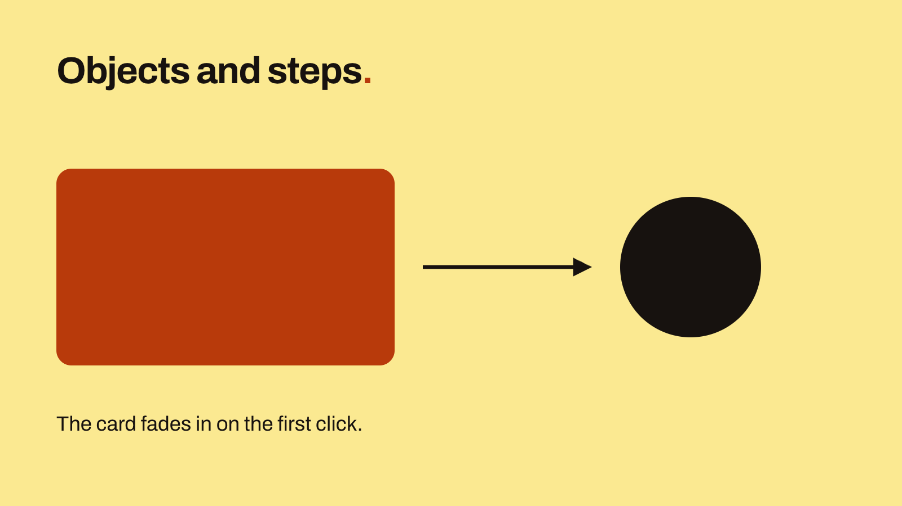

This slide's text is in the .md file:

```markdown
<!-- slide: shapes -->

<!-- text: heading -->
Objects and steps==.==

<!-- text: caption -->
The card fades in on the first click.

<!-- notes -->
This slide has two texts, two shapes and a line with an arrow, on the Blank layout. One step fades the card in.
```

The slide's objects and animation are in the .mdpoint file:

```json
{
  "markdownpoint": "1.0",
  "type": "presentation",
  "id": "64ea077f-d2ca-4f8c-9015-61feb4de5cb8",
  "theme": "basic",
  "slides": {
    "shapes": {
      "layout": "blank",
      "scheme": "butter",
      "objects": [
        {
          "id": "heading",
          "type": "text",
          "frame": {"x": 120, "y": 110, "width": 1680, "height": 150},
          "text-style": "title"
        },
        {
          "id": "card",
          "type": "shape",
          "shape-type": "rectangle",
          "frame": {"x": 120, "y": 360, "width": 720, "height": 420},
          "corner-radius": 32
        },
        {
          "id": "dot",
          "type": "shape",
          "shape-type": "ellipse",
          "frame": {"x": 1320, "y": 420, "width": 300, "height": 300},
          "fill": "text"
        },
        {
          "id": "arrow",
          "type": "line",
          "start": {"x": 900, "y": 570},
          "end": {"x": 1260, "y": 570},
          "cap-end": "arrow",
          "stroke-weight": 8
        },
        {
          "id": "caption",
          "type": "text",
          "frame": {"x": 120, "y": 860, "width": 1680, "height": 80},
          "text-style": "body"
        }
      ],
      "initial": {"card.opacity": 0},
      "steps": [
        {
          "id": "fade-in",
          "name": "Fade in the card",
          "min-duration": 0.6,
          "curves": {
            "card.opacity": {
              "keyframes": [
                {"id": "card-shows", "time": 0.6, "value": 1, "interpolation": "ease-out"}
              ]
            }
          }
        }
      ]
    }
  }
}
```

Saved JSON has each object property, and each key inside a `frame` or a `transition`, on a line of its own. A blank line separates one object or override from the next. A line-based merge, such as Git's, can then keep most separate edits apart. Edits to the same or adjacent lines still conflict, and a move and a resize of the same object change adjacent lines. The examples on this page use a more compact layout.

A merge conflict that git leaves in the file is an error. MarkdownPoint shows the line where it starts and won't open the presentation until you resolve it.

Saving preserves the formatting of unchanged parts of the file. Edited parts are written in MarkdownPoint's standard format: a fixed key order, omitted defaults, and most numbers rounded to six decimal places. A save that changes only text leaves the .mdpoint file unchanged. “Save a Copy…” and joining a shared presentation write the whole .mdpoint file in the standard format. Run `mdpoint format` to reformat both files.

When rounding to six decimal places changes a number in the file, MarkdownPoint warns once when it opens the presentation.

## Slides

The keys in `slides` match the slide ids in the .md file, and the .md file sets their order. `layout` selects a layout from the theme. `scheme` selects a color scheme. If it's omitted, the slide uses its layout's scheme. A scheme or override value set on the slide stays even when it equals the inherited value. A later change to the theme doesn't change it. Only a reset removes it. The slide then follows changes to that value in the theme.

## Presentation settings

Settings for the whole presentation are next to `slides`:

```json
{
  "markdownpoint": "1.0",
  "type": "presentation",
  "id": "318494ee-4e44-456f-818a-ec761b41fec2",
  "theme": "basic",
  "countdown": 600,
  "default-text-style": {"text-style": "body", "color": "accent"},
  "image-style": "Flat illustration",
  "swatches": ["#2F7D4F", "#FA7B26"],
  "slides": {
    "close": {"layout": "one-liner"},
    "points": {"layout": "content-with-header", "scheme": "sky"},
    "title": {"layout": "title"}
  }
}
```

`countdown` is how long the talk should take, in seconds. The presenter's timer counts down from it. A new text box uses `default-text-style`. `swatches` are the colors saved for this presentation. A generated image object that names no style of its own uses the style in `image-style`, and a generated background uses `background-image-style`. When either is omitted, no style is used.

## Objects

`objects` lists the slide's objects from back to front. Each has an `id` and a `type`. `frame` is its position and size in canvas units, measured from the slide's top left. A canvas unit is one pixel of the slide at full size. The theme sets that size, here 1920 by 1080.

Text for a text object or shape goes in the .md file under `<!-- text: id -->`. Use the object's id in the marker.

The dot's fill is `text`, a role in the slide's color scheme. The dot changes color with the scheme. A hex color such as `"#FA7B26"` stays the same in every scheme.

Omitted keys use their defaults. The card has no fill specified and uses `accent`, the default for shapes. The [object reference](reference/v1.md#object) lists the required keys, allowed values, and defaults for each object type.

A text box can grow to fit its words, give every digit the same width, and outline its letters:

```json
[
  {
    "id": "grows",
    "type": "text",
    "frame": {"x": 120, "y": 340, "width": 760},
    "text-style": "body",
    "auto-size": "height"
  },
  {
    "id": "figures",
    "type": "text",
    "frame": {"x": 1100, "y": 340, "width": 700, "height": 400},
    "text-style": "body",
    "align": "right",
    "tabular": true
  },
  {
    "id": "outline",
    "type": "text",
    "frame": {"x": 120, "y": 760, "width": 1680, "height": 180},
    "text-style": "display",
    "color": "background",
    "text-stroke": "accent",
    "text-stroke-weight": 3
  }
]
```

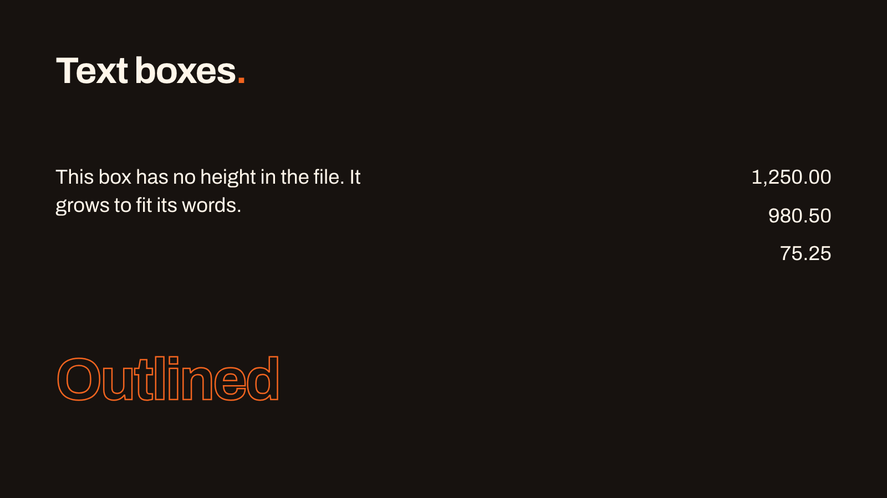

`auto-size` names the sides that grow, here the height. The frame then has no height, and the box is as tall as its words. With `tabular`, right-aligned figures line up. `text-stroke` is the color of a stroke around each letter, and `text-stroke-weight` is its thickness in canvas units.

A chart draws the Markdown table in its text block:

```markdown
<!-- slide: data -->

<!-- text: title -->
Tables and charts==.==

<!-- text: specs -->
| Size | 1920 × 1080 |
| --- | --- |
| Frame rate | 60 fps |
| Film | MP4 |

<!-- text: sales -->
| Quarter | North | South |
| --- | --- | --- |
| Q1 | 40 | 24 |
| Q2 | 65 | 48 |
| Q3 | 52 | 71 |
| Q4 | 90 | 60 |

<!-- text: visitors -->
| Visitors | Count |
| --- | --- |
| Total | 1280 |

<!-- notes -->
The table's first column is its header (`header-column`), and its first row is a row like the others (`header-row` set to `false`). The chart's `colors` give its two series the text and accent colors. The counter rolls its digits (`roll`). With a `progress` of 0.5, it shows the halfway value, 0640. Its unused leading zero has an opacity of 0.4 (`leading-zero-opacity`).
```

```json
[
  {
    "id": "specs",
    "type": "table",
    "frame": {"x": 120, "y": 340},
    "text-style": "body",
    "column-widths": [380, 380],
    "header-row": false,
    "header-column": true
  },
  {
    "id": "sales",
    "type": "chart",
    "frame": {"x": 1000, "y": 340, "width": 800, "height": 420},
    "colors": ["text", "accent"]
  },
  {
    "id": "visitors",
    "type": "chart",
    "chart-type": "counter",
    "frame": {"x": 120, "y": 760, "width": 760, "height": 200},
    "progress": 0.5,
    "roll": true,
    "leading-zero-opacity": 0.4
  }
]
```

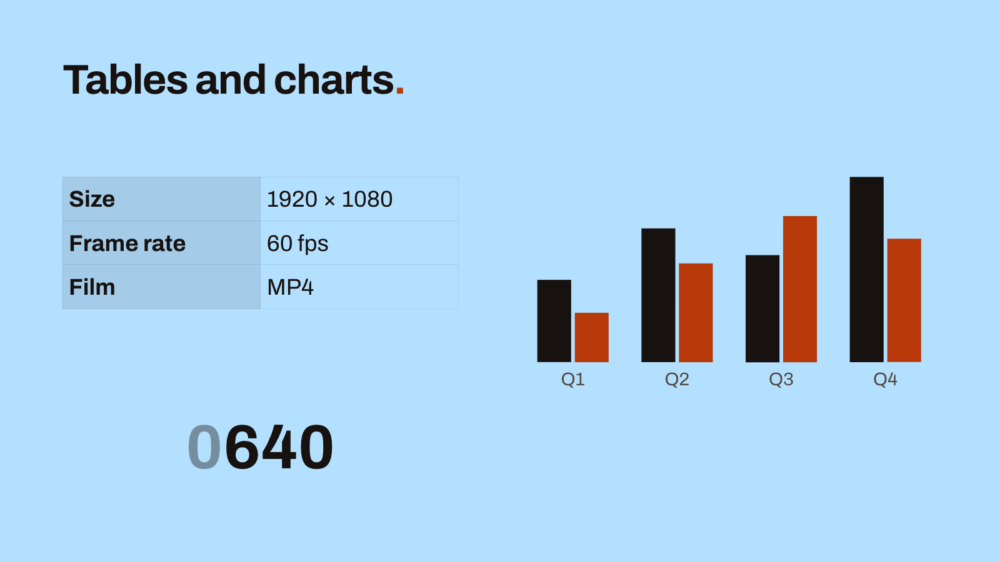

Here the table's first column is its header, instead of its first row. `colors` sets the color of each series in the chart, or of each category in a pie or donut chart. A counter with `roll` rolls its digits into place. Here its `progress` is below 1. The counter then shows its unused leading zeros at `leading-zero-opacity`.

A group with `auto-layout` places its members one after another, down or across, and ignores their own positions:

```json
[
  {
    "id": "heading",
    "type": "text",
    "frame": {"x": 120, "y": 110, "width": 1680, "height": 150},
    "text-style": "title"
  },
  {
    "id": "row",
    "type": "group",
    "auto-layout": {
      "direction": "horizontal",
      "gap": 40,
      "align": "center",
      "position": {"x": 320, "y": 400}
    }
  },
  {
    "id": "left",
    "type": "shape",
    "shape-type": "ellipse",
    "parent": "row",
    "frame": {"x": 0, "y": 0, "width": 360, "height": 360},
    "fill": "text"
  },
  {
    "id": "middle",
    "type": "shape",
    "shape-type": "rectangle",
    "parent": "row",
    "frame": {"x": 0, "y": 0, "width": 480, "height": 240},
    "constrain-proportions": false,
    "corner-radius": 32
  },
  {
    "id": "right",
    "type": "shape",
    "shape-type": "rectangle",
    "parent": "row",
    "frame": {"x": 0, "y": 0, "width": 360, "height": 360},
    "fill": "text"
  }
]
```

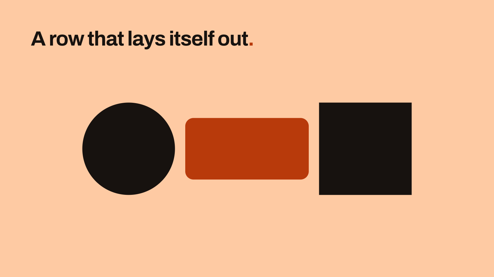

## Images

An image object shows a picture from the presentation's `media` folder. `exposure`, `contrast`, `saturation`, and `temperature` range from −1 to 1, and `grayscale` from 0 to 1. At 0, the picture is shown as shot. This one has more contrast and color:

```json
{
  "id": "vivid",
  "type": "image",
  "file": "media/hills.png",
  "frame": {"x": 980, "y": 400, "width": 390, "height": 219},
  "contrast": 0.4,
  "saturation": 0.6,
  "alt": "The hills, with more contrast and color"
}
```

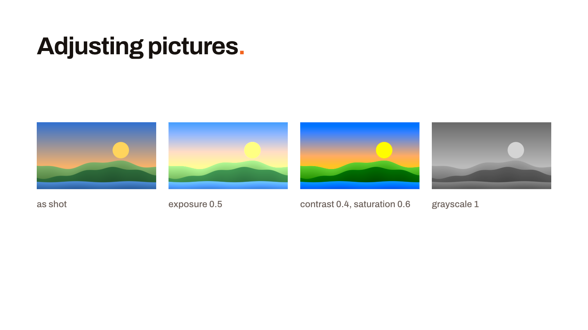

A slide's `background` can be a picture too. The picture covers the slide. `crop` zooms in on a point, and `opacity` lets the scheme's color show through:

```json
{
  "image": "media/hills.png",
  "crop": {"scale": 1.6, "focal-point": {"x": 0.7, "y": 0.42}},
  "opacity": 0.3,
  "grayscale": 1
}
```

A picture with transparency casts its `drop-shadow` in its own shape:

```json
{
  "image": "media/sun.png",
  "drop-shadow": {"size": 48, "offset": {"x": 0, "y": 16}, "color": "#000000", "opacity": 0.3}
}
```

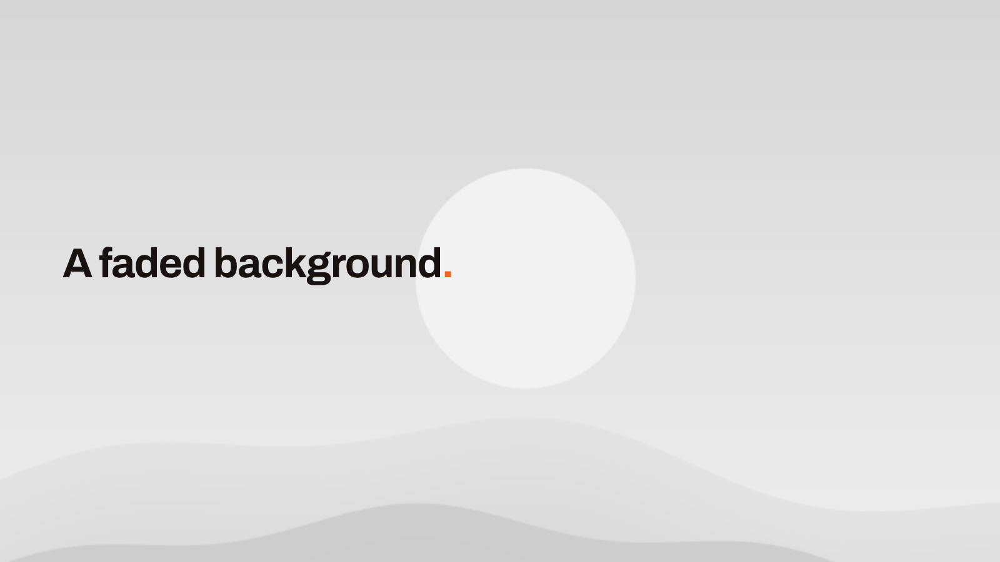 

A generated image starts as a request. The image object or the slide's `background` contains its `prompt`, its `image-style`, and whether it asks for a `transparent-background`. `restyle` contains the style applied to a picture: its name, its prompt, and whether its images have transparent backgrounds. These are copied from the style library when the author chooses a style there. MarkdownPoint saves each picture in `generated/` when the author generates it. The boat has been generated. Its `file` is its picture, and `generation` names its image generation record:

```json
{
  "id": "boat",
  "type": "image",
  "file": "generated/b0bebb75-dc72-4d54-965e-64824ba62d02.png",
  "name": "Red Paper Boat",
  "frame": {"x": 120, "y": 340, "width": 760, "height": 428},
  "stroke": "muted",
  "stroke-weight": 4,
  "stroke-style": "dashed",
  "alt": "A red paper boat",
  "transparent-background": true,
  "prompt": "A red paper boat on calm water",
  "image-style": "Flat illustration",
  "generation": {"id": "b0bebb75-dc72-4d54-965e-64824ba62d02"}
}
```

The image generation record, `generated/<id>.json`, contains the request and the image it produced:

```json
{
  "markdownpoint": "1.0",
  "type": "image-generation",
  "created": "2026-11-03T17:59:43.070Z",
  "name": "Red Paper Boat",
  "target": {"type": "image-object", "slide": "generate", "object": "boat"},
  "request": {
    "instructions": "markdownpoint/image-prompt/1",
    "prompt": "A red paper boat on calm water",
    "image-style": "Flat illustration",
    "provider": "openai",
    "model": "gpt-image-2.5-sunburst",
    "parameters": {
      "aspect-ratio": "190:107",
      "transparent-background": true,
      "size": "2048",
      "quality": "medium"
    }
  },
  "output": {
    "file": "generated/b0bebb75-dc72-4d54-965e-64824ba62d02.png",
    "sha256": "eef207da6283bb997d08942b62db521060af1f513c4ac93da5551601716f98bb",
    "bytes": 2277188,
    "width": 2045,
    "height": 1152
  }
}
```

The hills have a restyle, and the background is still a request:

```json
{
  "id": "chalk",
  "type": "image",
  "file": "media/hills.png",
  "frame": {"x": 1040, "y": 340, "width": 760, "height": 428},
  "alt": "Green hills under a low sun",
  "restyle": {"name": "Chalk", "prompt": "Redraw it in white chalk on a blackboard"}
}
```

```json
{
  "prompt": "Paper leaves cut out along the slide's lower edge",
  "image-style": "Paper cutout",
  "transparent-background": true
}
```

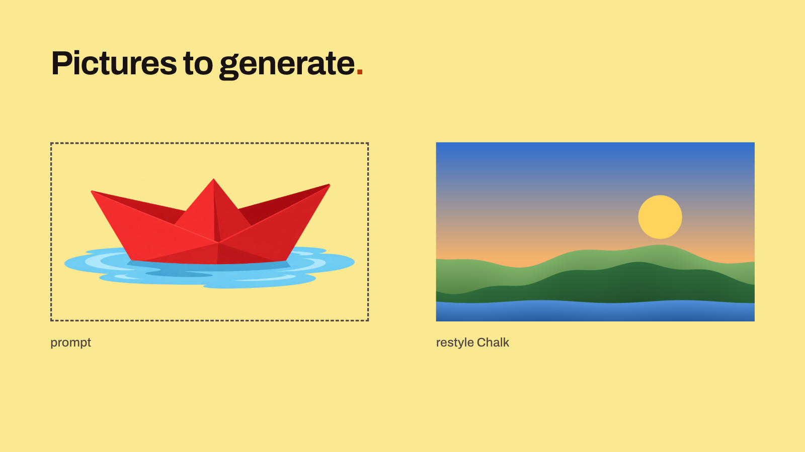

## Audio and video

A video or audio object plays on a click. With `start-on-click` set to false, it starts when its slide appears. With `media-trim`, only part of the file plays, from `start` to `end`, in seconds:

```json
{
  "id": "clip",
  "type": "video",
  "file": "media/hills.mp4",
  "frame": {"x": 120, "y": 330, "width": 960, "height": 540},
  "alt": "A slow zoom on green hills under a low sun",
  "media-trim": {"start": 1, "end": 5}
}
```

A video's or an audio object's `fade-in` and `fade-out` are in seconds:

```json
{
  "id": "chime",
  "type": "audio",
  "file": "media/chord.m4a",
  "name": "Chord",
  "icon-position": {"x": 1160, "y": 700},
  "start-on-click": false,
  "fade-in": 0.5,
  "fade-out": 1.5
}
```

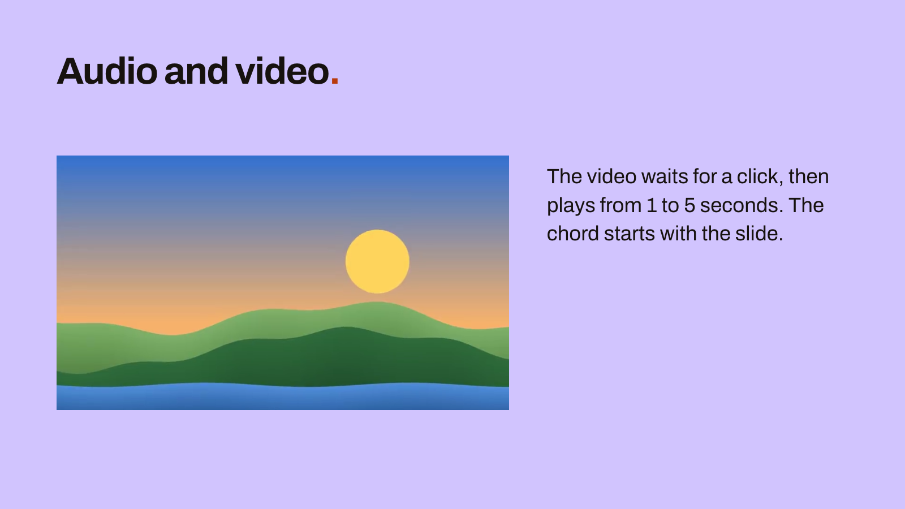

With `soundtrack`, one audio file plays through the whole presentation, with its own fades:

```json
{"file": "media/chord.m4a", "fade-in": 2, "fade-out": 3}
```

## 3D

Models, lights, and the camera are placed in a 3D space. A constraint applies a rule to one of them as things move. `aim` turns a model, or the node of it named by `node`, toward a target. `squash-and-stretch` preserves a model's volume while a step scales it:

```json
[{"id": "look", "type": "aim", "node": "shade", "target": "mug", "axis": "-y", "strength": 0.5}]
```

```json
{
  "id": "mug",
  "type": "model",
  "file": "media/coffee-cup-baf4d2ac.glb",
  "name": "Mug",
  "position": {"x": 1260, "y": 160, "z": 0},
  "rotation-mode": "quaternion",
  "rotation": {"w": 0.965926, "x": 0, "y": -0.258819, "z": 0},
  "scale": {"x": 3, "y": 3, "z": 3},
  "constraints": [
    {
      "id": "stretch",
      "type": "squash-and-stretch",
      "mode": "single-axis",
      "free-axis": "x",
      "volume": 0.9,
      "strength": 0.9
    }
  ],
  "alt": "A coffee mug"
}
```

The camera is defined on the master, and a slide changes it in `overrides`. Its `position` constraint follows an object, and its `motion-blur` blurs the 3D layer in movies:

```json
{
  "constraints": [
    {
      "id": "follow",
      "type": "position",
      "target": "mug",
      "axes": ["x"],
      "relative-to-target": false,
      "strength": 0.25
    }
  ],
  "motion-blur": {"frame-position": "start"}
}
```

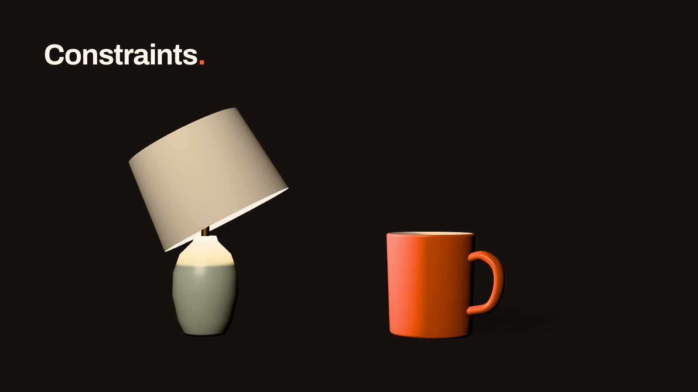

A rotation in degrees applies the heading around y, then the pitch around the object's own x, then the bank around its own z. With `rotation-mode` set to `quaternion`, a rotation is written as w, x, y, and z.

## Steps

`initial` sets a parameter's value at the start of the slide. The parameter is written as `object.parameter`. Here the card starts at an `opacity` of 0.

`steps` lists the slide's animation steps in playback order. A step normally starts on a click. Set `start` to `with` or `after` to start it with or after the previous step. On the first step, `with` and `after` both start it when the slide's transition ends. During a scroll transition, the next slide's first step plays as the slide moves in, regardless of its `start` setting.

`curves` lists animated parameters as `object.parameter`. A parameter's keyframes are in its curve's `keyframes`. Each keyframe specifies a value and a `time` in seconds from the start of the step. To delay a move, set the keyframe's `start`. There is no separate step delay. In this example, the card fades in over 0.6 seconds. A step with no `min-duration`, or a `min-duration` of 0, lasts as long as its keyframes, its cues, and the paragraphs they bring in.

Five settings can repeat motion while a slide is visible: a step's `repeat-count` and `loop-from`, a curve's `loop`, an `oscillate` wave, and an Action clip's `loop`. Camera [drift](reference/v1.md#drift) doesn't repeat and requires a `duration`.

## Motion

The [motion example](examples/motion) includes a repeater, named curves and springs, loops, waves, an interrupted move, a curved path, a composition at four moments, text animations, and transitions. Each slide's speaker notes identify the relevant properties.

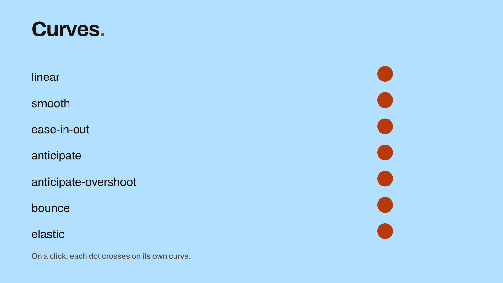 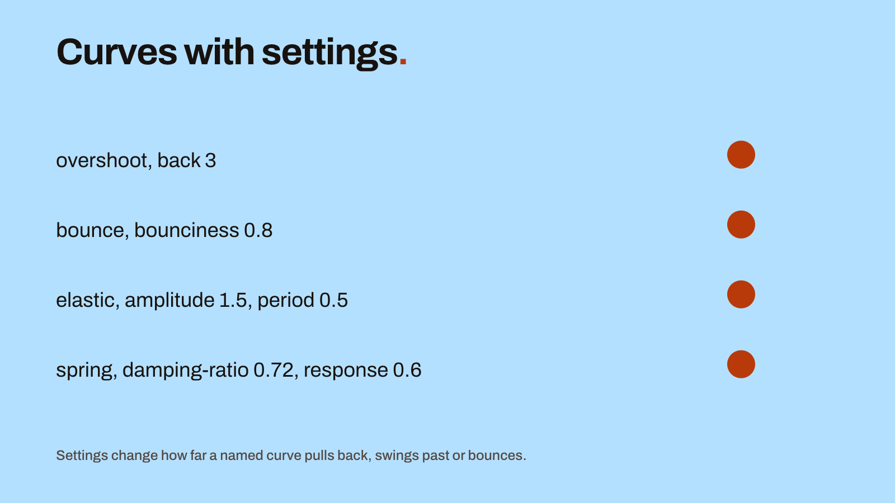

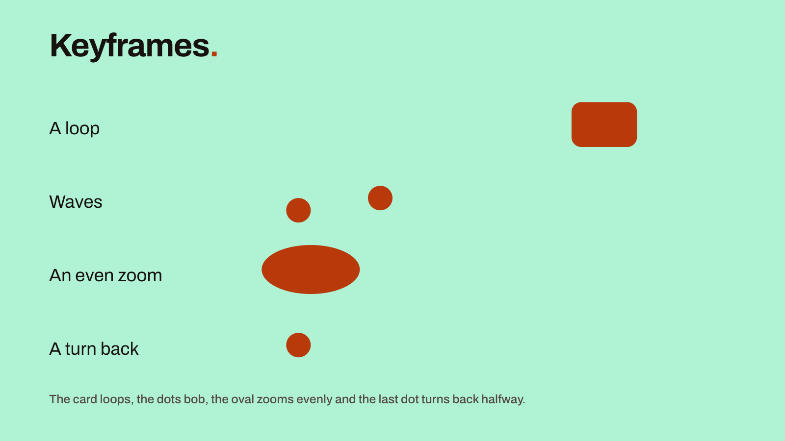 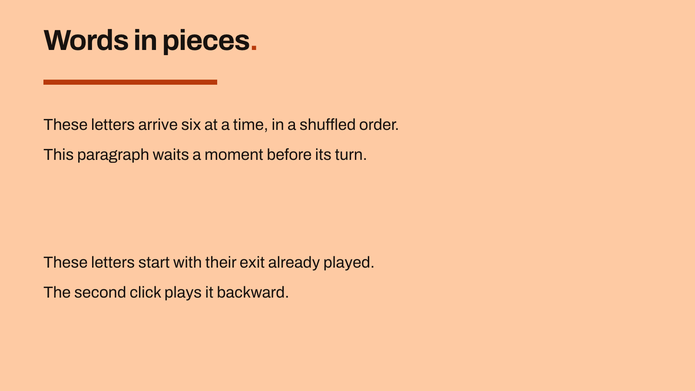

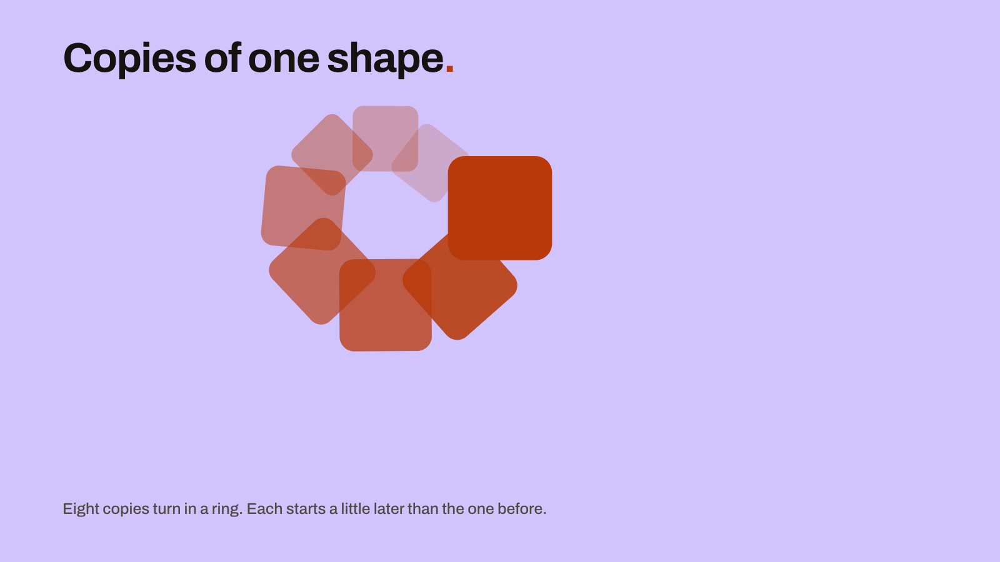 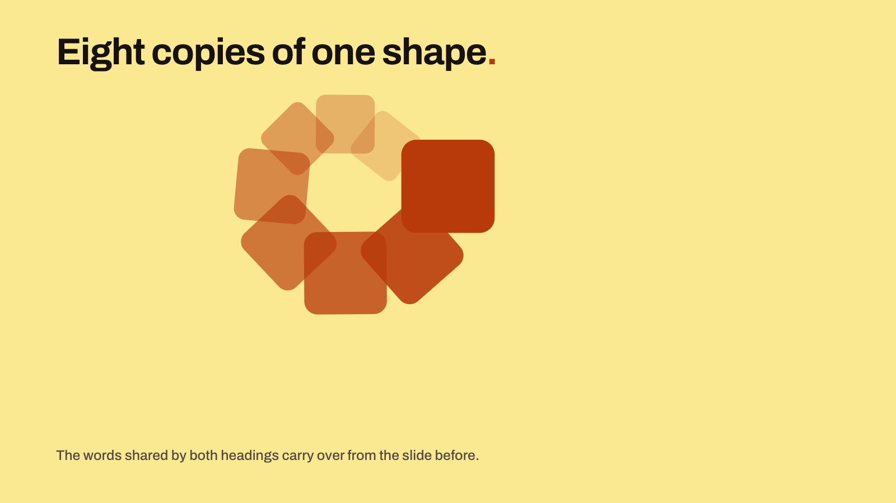

Set a keyframe's `interpolation` to a named curve. To give it settings, use a record with its name in `type`:

```json
[
  {
    "id": "race",
    "name": "Race the curves",
    "min-duration": 3,
    "curves": {
      "dot-bounce.translation.x": {
        "keyframes": [
          {
            "id": "bounce-arrives",
            "time": 2,
            "value": 540,
            "interpolation": {"type": "bounce", "bounciness": 0.8}
          }
        ]
      },
      "dot-elastic.translation.x": {
        "keyframes": [
          {
            "id": "elastic-arrives",
            "time": 2,
            "value": 540,
            "interpolation": {"type": "elastic", "amplitude": 1.5, "period": 0.5}
          }
        ]
      },
      "dot-overshoot.translation.x": {
        "keyframes": [
          {
            "id": "overshoot-arrives",
            "time": 2,
            "value": 540,
            "interpolation": {"type": "overshoot", "back": 3}
          }
        ]
      },
      "dot-spring.translation.x": {
        "keyframes": [
          {
            "id": "spring-arrives",
            "time": 2,
            "value": 540,
            "interpolation": {"type": "spring", "amount": 0.4, "response": 0.6}
          }
        ]
      }
    }
  }
]
```

A composition is a reusable animated scene, defined under `compositions`. Each instance on a slide shows one moment of it, set by its `time-remap` in seconds. Without `time-remap`, the instance shows the last moment:

```json
{
  "id": "early",
  "type": "instance",
  "composition": "sweep",
  "frame": {"x": 120, "y": 320, "width": 800, "height": 240},
  "time-remap": 0.5
}
```

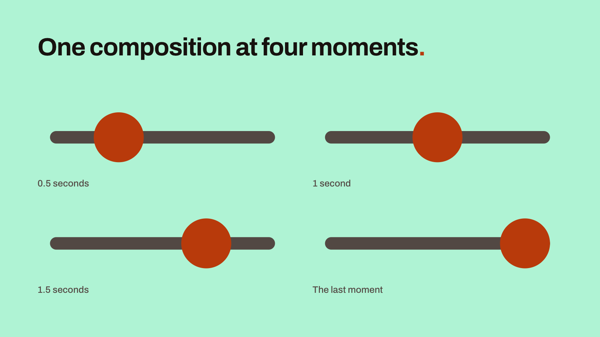

## Keys MarkdownPoint doesn't read

An unknown JSON key or value is an error in a file that uses the current format version. In a file from a later minor version, such as 1.3, MarkdownPoint keeps the new keys and values when it saves. [Format versions](README.md#format-versions) gives the one exception.

To keep your own data with a presentation, write it in the .md file's [frontmatter](md-file.md#frontmatter). MarkdownPoint preserves the keys there that it doesn't read.
