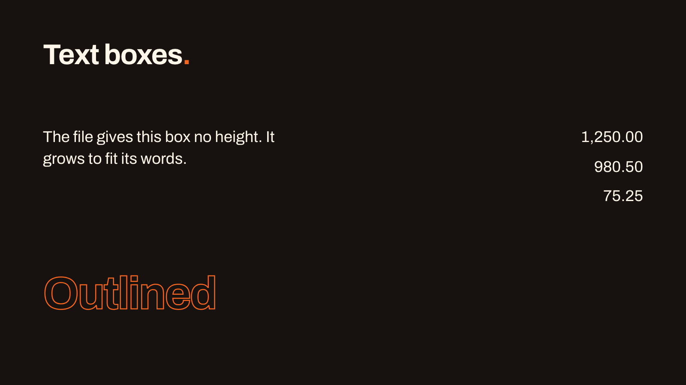
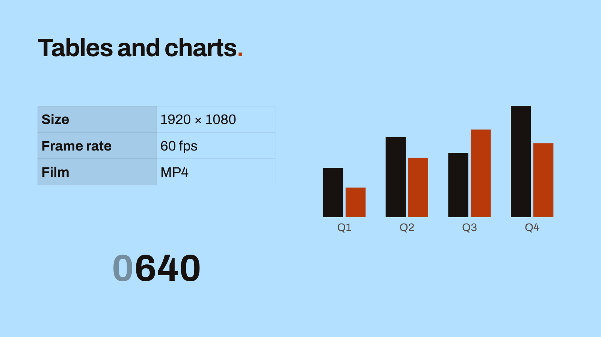
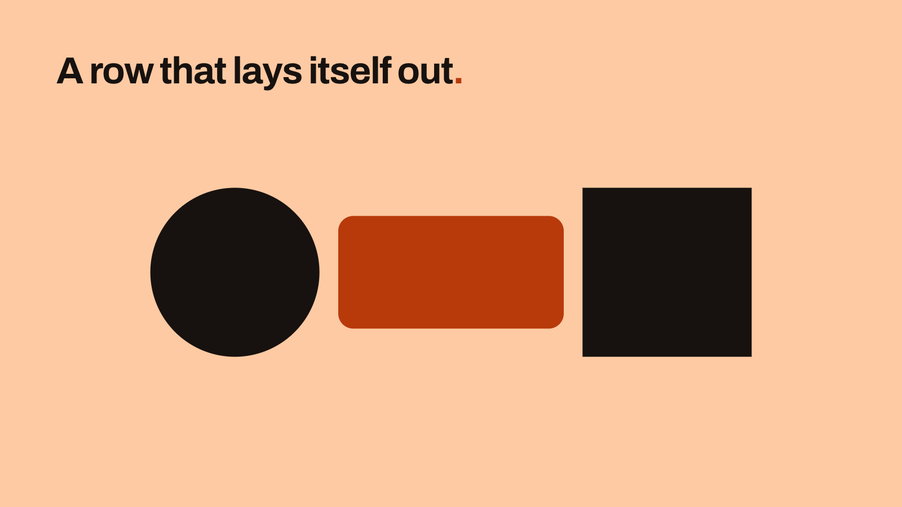
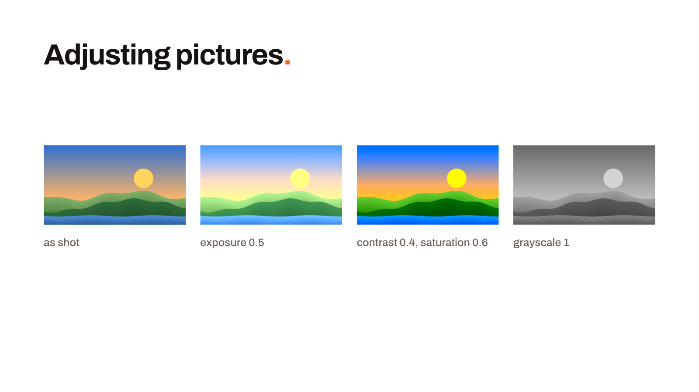
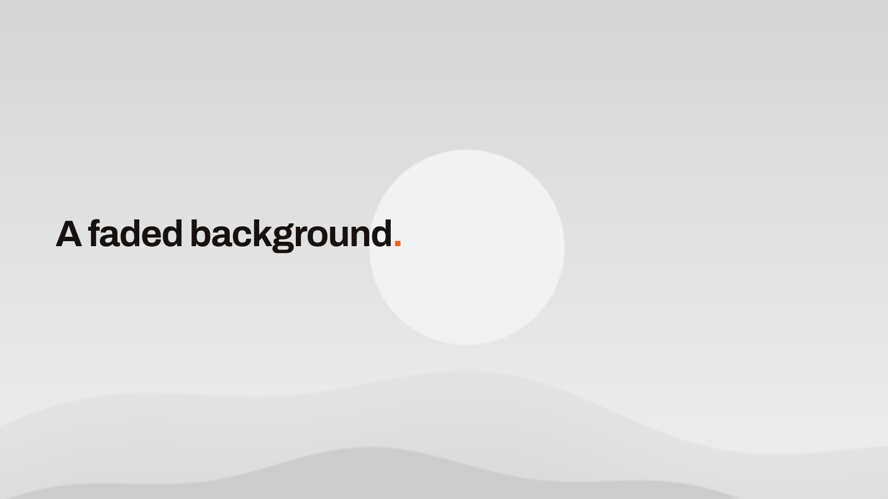
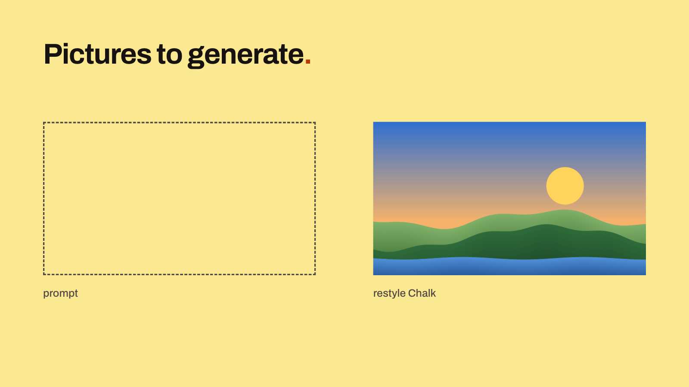
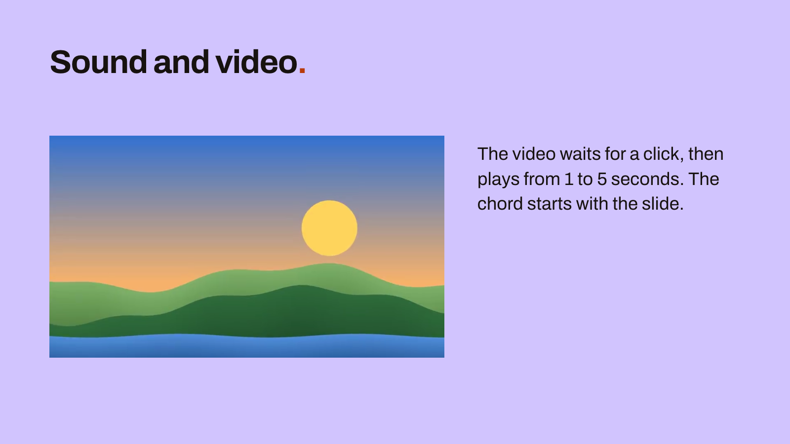
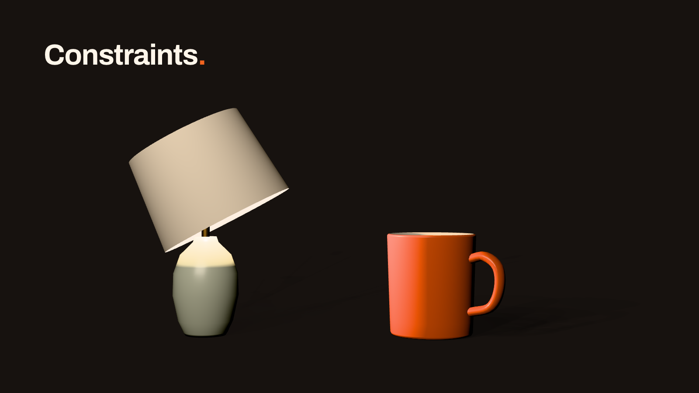
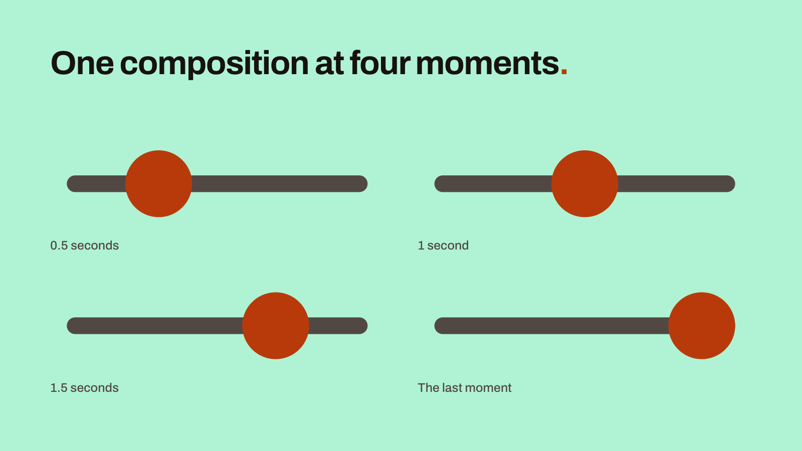

# The .mdpoint file

`presentation.mdpoint` is JSON. It selects the theme and records each slide's layout, objects, properties and motion. The presentation's text and slide order are in [slides.md](md-file.md).

The presentation's name is its folder's. Rename the folder to rename the presentation.


This slide's text is in the .md file:

```markdown
<!-- slide: shapes -->

<!-- text: heading -->
Objects and steps==.==

<!-- text: caption -->
The card fades in on the first click.

<!-- notes -->
Two texts, two shapes and a line with an arrow, drawn on the Blank layout. One step fades the card in.
```

The slide's objects and motion are in the .mdpoint file:

```json
{
  "markdownpoint": "1.0",
  "kind": "presentation",
  "id": "64ea077f-d2ca-4f8c-9015-61feb4de5cb8",
  "theme": "basic",
  "slides": {
    "shapes": {
      "layout": "blank",
      "scheme": "butter",
      "objects": [
        {
          "id": "heading",
          "type": "text",
          "frame": {"x": 120, "y": 110, "width": 1680, "height": 150},
          "text-style": "title"
        },
        {
          "id": "card",
          "type": "shape",
          "shape": "rectangle",
          "frame": {"x": 120, "y": 360, "width": 720, "height": 420},
          "corner-radius": 32
        },
        {
          "id": "dot",
          "type": "shape",
          "shape": "ellipse",
          "frame": {"x": 1320, "y": 420, "width": 300, "height": 300},
          "fill": "text"
        },
        {
          "id": "arrow",
          "type": "line",
          "start": {"x": 900, "y": 570},
          "end": {"x": 1260, "y": 570},
          "cap-end": "arrow",
          "stroke-weight": 8
        },
        {
          "id": "caption",
          "type": "text",
          "frame": {"x": 120, "y": 860, "width": 1680, "height": 80},
          "text-style": "body"
        }
      ],
      "initial": {"card.opacity": 0},
      "steps": [
        {
          "id": "fade-in",
          "name": "Fade in the card",
          "duration": 0.6,
          "curves": {
            "card.opacity": {
              "keyframes": [
                {"id": "card-shows", "time": 0.6, "value": 1, "interpolation": "ease-out"}
              ]
            }
          }
        }
      ]
    }
  }
}
```

Saved JSON gives a line of its own to each object property and to each key inside a `frame` or a `transition`. A blank line separates one object or override from the next. A line-based merge such as Git's then keeps most separate edits apart. Edits to the same or touching lines still conflict. A move and a resize of the same object change touching lines. The examples on this page use a more compact layout.

Saves preserve formatting in unchanged parts of the file. Edited parts use MarkdownPoint's standard format: a fixed key order, omitted defaults and most numbers rounded to six decimal places. Text-only saves leave the .mdpoint file unchanged. Run `mdpoint format` to reformat both files.

## Slides

The keys in `slides` match the slide IDs in the .md file. The Markdown file sets their order. `layout` selects a layout from the theme. `scheme` selects a color scheme; if omitted, the slide uses its layout's scheme. A scheme or override value the slide states stays, even one that equals the inherited value, so a later theme change leaves it as it is. Only a reset removes it. The slide then follows changes to that value in the theme.

## Presentation settings

Settings for the whole presentation stand beside `slides`:

```json
{
  "markdownpoint": "1.0",
  "kind": "presentation",
  "id": "318494ee-4e44-456f-818a-ec761b41fec2",
  "theme": "basic",
  "countdown": 600,
  "default-text-style": {"text-style": "body", "color": "accent"},
  "image-style": "Flat illustration",
  "swatches": ["#2F7D4F", "#FA7B26"],
  "slides": {
    "close": {"layout": "one-liner"},
    "points": {"layout": "content-with-header", "scheme": "sky"},
    "title": {"layout": "title"}
  }
}
```

`countdown` is how long the talk should take, in seconds. The presenter's timer counts down from it. A new text box takes `default-text-style`. `swatches` are the colors saved for this presentation. A generated image that names no style of its own is made in `image-style`.

## Objects

`objects` lists the slide's objects from back to front. Each has an `id` and a `type`. `frame` is its position and size in canvas units, from the slide's top left. A canvas unit is one pixel of the slide at full size. The theme sets that size: 1920 by 1080 here.

Text for a text object or shape goes in the .md file under `<!-- text: id -->`. Use the object's ID in the marker.

The dot's fill, `text`, is a role in the slide's color scheme, so the dot changes color with the scheme. A hex color such as `"#FA7B26"` stays the same in every scheme.

Omitted keys use their defaults. The card has no fill specified and uses `accent`, the default for shapes. The [object reference](reference/v1.md#object) lists the required keys, allowed values and defaults for each object type.

A text box can grow to fit its words, give every digit one width and outline its letters:

```json
[
  {
    "id": "grows",
    "type": "text",
    "frame": {"x": 120, "y": 340, "width": 760},
    "text-style": "body",
    "auto-size": "height"
  },
  {
    "id": "figures",
    "type": "text",
    "frame": {"x": 1100, "y": 340, "width": 700, "height": 400},
    "text-style": "body",
    "align": "right",
    "tabular": true
  },
  {
    "id": "outline",
    "type": "text",
    "frame": {"x": 120, "y": 760, "width": 1680, "height": 180},
    "text-style": "display",
    "color": "background",
    "text-stroke": "accent",
    "text-stroke-weight": 3
  }
]
```



`auto-size` names the sides that grow, here the height, so the frame holds no height: the box is as tall as its words. With `tabular`, right-aligned figures line up. `text-stroke` is the color of a stroke around each letter, and `text-stroke-weight` its width in canvas units.

A chart draws the Markdown table in its text block:

```markdown
<!-- slide: data -->

<!-- text: title -->
Tables and charts==.==

<!-- text: specs -->
| Size | 1920 × 1080 |
| --- | --- |
| Frame rate | 60 fps |
| Film | MP4 |

<!-- text: sales -->
| Quarter | North | South |
| --- | --- | --- |
| Q1 | 40 | 24 |
| Q2 | 65 | 48 |
| Q3 | 52 | 71 |
| Q4 | 90 | 60 |

<!-- text: visitors -->
| Visitors | Count |
| --- | --- |
| Total | 1280 |

<!-- notes -->
The table's first column is its header, and its first row is a row like the others. The chart's colors give its two series the text and accent colors. The counter rolls its digits. Its progress of 0.5 stands it halfway, at 0640, with the unused leading zero at 0.4 opacity.
```

```json
[
  {
    "id": "specs",
    "type": "table",
    "frame": {"x": 120, "y": 340, "width": 760},
    "text-style": "body",
    "columns": [380, 380],
    "header-row": false,
    "header-column": true
  },
  {
    "id": "sales",
    "type": "chart",
    "frame": {"x": 1000, "y": 340, "width": 800, "height": 420},
    "colors": ["text", "accent"]
  },
  {
    "id": "visitors",
    "type": "chart",
    "chart-type": "counter",
    "frame": {"x": 120, "y": 760, "width": 760, "height": 200},
    "progress": 0.5,
    "roll": true,
    "leading-zero-opacity": 0.4
  }
]
```



Here the table's first column is its header, in place of its first row. `colors` sets the color of each of the chart's series. A counter with `roll` turns its digits into place. Stopped short of 1, its `progress` shows the unused leading zeros at `leading-zero-opacity`.

A group with `auto-layout` places its members one after another, down or across. Their own positions are ignored:

```json
[
  {
    "id": "heading",
    "type": "text",
    "frame": {"x": 120, "y": 110, "width": 1680, "height": 150},
    "text-style": "title"
  },
  {
    "id": "row",
    "type": "group",
    "auto-layout": {
      "direction": "horizontal",
      "gap": 40,
      "alignment": "center",
      "position": {"x": 320, "y": 400}
    }
  },
  {
    "id": "left",
    "type": "shape",
    "shape": "ellipse",
    "parent": "row",
    "frame": {"x": 0, "y": 0, "width": 360, "height": 360},
    "fill": "text"
  },
  {
    "id": "middle",
    "type": "shape",
    "shape": "rectangle",
    "parent": "row",
    "frame": {"x": 0, "y": 0, "width": 480, "height": 240},
    "constrain-proportions": false,
    "corner-radius": 32
  },
  {
    "id": "right",
    "type": "shape",
    "shape": "rectangle",
    "parent": "row",
    "frame": {"x": 0, "y": 0, "width": 360, "height": 360},
    "fill": "text"
  }
]
```



## Pictures

An image object shows a picture from the presentation's `media` folder. `exposure`, `contrast` and `saturation` run from −1 to 1, and `grayscale` from 0 to 1. At 0, the picture shows as shot:

```json
{
  "id": "vivid",
  "type": "image",
  "file": "media/hills.png",
  "frame": {"x": 980, "y": 400, "width": 390, "height": 219},
  "contrast": 0.4,
  "saturation": 0.6,
  "alt": "The hills, with more contrast and color"
}
```



A slide's `background` can be a picture too. It covers the slide. `crop` zooms in on a point, and `opacity` lets the scheme's color show through:

```json
{
  "image": "media/hills.png",
  "crop": {"scale": 1.6, "focal-point": {"x": 0.7, "y": 0.42}},
  "opacity": 0.3,
  "grayscale": 1
}
```

A picture with transparency casts its `drop-shadow` from its shape:

```json
{
  "image": "media/sun.png",
  "drop-shadow": {"blur": 40, "offset": {"x": 0, "y": 16}, "color": "#000000", "opacity": 0.3}
}
```

 

A generated picture starts as a request. An image object or a slide's `background` holds its `prompt`, its `image-style` and whether it's `transparent`. `restyle` names a library style applied over a picture. MarkdownPoint makes each picture when the author generates it, under generated/:

```json
{
  "id": "boat",
  "type": "image",
  "frame": {"x": 120, "y": 340, "width": 760, "height": 428},
  "stroke": "muted",
  "stroke-weight": 4,
  "stroke-style": "dashed",
  "alt": "A red paper boat",
  "transparent": true,
  "prompt": "A red paper boat on calm water",
  "image-style": "Flat illustration"
}
```

```json
{
  "id": "chalk",
  "type": "image",
  "file": "media/hills.png",
  "frame": {"x": 1040, "y": 340, "width": 760, "height": 428},
  "alt": "Green hills under a low sun",
  "restyle": {
    "name": "Chalk",
    "reference-prompt": "A harbor at dawn",
    "prompt": "Redraw it in white chalk on a blackboard"
  }
}
```

```json
{
  "prompt": "Paper leaves cut out along the slide's lower edge",
  "image-style": "Paper cutout",
  "transparent": true
}
```



## Sound and video

A video or a sound waits for a click to play. With `start-on-click` set to false, it starts when its slide appears. `media-trim` plays part of its file, from `start` to `end` in seconds:

```json
{
  "id": "clip",
  "type": "video",
  "file": "media/hills.mp4",
  "frame": {"x": 120, "y": 330, "width": 960, "height": 540},
  "alt": "A slow zoom on green hills under a low sun",
  "media-trim": {"start": 1, "end": 5}
}
```

A sound's `fade-in` and `fade-out` are in seconds:

```json
{
  "id": "chime",
  "type": "audio",
  "file": "media/chord.m4a",
  "name": "Chord",
  "position": {"x": 1160, "y": 700},
  "start-on-click": false,
  "fade-in": 0.5,
  "fade-out": 1.5
}
```



`soundtrack` plays one sound under the whole presentation, with fades of its own:

```json
{"file": "media/chord.m4a", "fade-in": 2, "fade-out": 3}
```

## 3D

Models, lights and the camera stand in a 3D space. A constraint ties one of them to another. `aim` turns a model, or the node of it that `owner-joint` names, toward a target. `squash-and-stretch` keeps a model's volume while a step scales it:

```json
[
  {
    "id": "look",
    "type": "aim",
    "owner-joint": "shade",
    "target": "mug",
    "axis": "-y",
    "strength": 0.5
  }
]
```

```json
{
  "id": "mug",
  "type": "model",
  "file": "media/coffee-cup-baf4d2ac.glb",
  "name": "Mug",
  "position": {"x": 1260, "y": 160, "z": 0},
  "rotation-mode": "quaternion",
  "rotation": {"w": 0.965926, "x": 0, "y": -0.258819, "z": 0},
  "scale": {"x": 3, "y": 3, "z": 3},
  "constraints": [
    {
      "id": "stretch",
      "type": "squash-and-stretch",
      "mode": "single-axis",
      "free-axis": "x",
      "volume": 0.9,
      "strength": 0.9
    }
  ],
  "alt": "A coffee mug"
}
```

The camera stands on the master. A slide changes it in `overrides`. Its `position` constraint follows an object, and its `motion-blur` blurs the 3D layer in films:

```json
{
  "constraints": [
    {
      "id": "follow",
      "type": "position",
      "target": "mug",
      "axes": ["x"],
      "offset": false,
      "strength": 0.25
    }
  ],
  "motion-blur": {"frame-position": "start"}
}
```



A rotation in degrees turns about y, then x, then z. With `rotation-mode` set to `quaternion`, it's written as w, x, y and z.

## Steps

`initial` sets a property's value at the start of the slide, as `object.property`. Here the card starts hidden.

`steps` lists the slide's builds in playback order. A step normally starts on a click. Set `start` to `with` or `after` to start it with or after the previous step. On the first step, `after` starts playback when the slide's transition ends. During a scroll transition, the next slide's first step plays as the slide moves in, regardless of its `start` setting.

`curves` lists animated properties as `object.property`. A property's curve holds its keyframes in `keyframes`. Each keyframe specifies a value and a `time` in seconds from the start of the step. To delay a move, set the keyframe's `start`. There is no separate step delay. In this example, the card fades in over 0.6 seconds. A step without a `duration` lasts as long as its keyframes, its cues and the paragraphs they bring in.

Four settings can repeat motion while a slide is visible: a curve's `loop`, an `oscillate` wave, a step's `loop-from` and an Action clip's `loop`. Camera [drift](reference/v1.md#drift) does not repeat and requires a `duration`.

## Motion

The [motion example](examples/motion) includes paths, loops, waves, text animations and transitions. Each slide's speaker notes identify the relevant properties.

 

 

 

Set a keyframe's `interpolation` to a curve name. To supply settings, use a record with the name in `curve`:

```json
[
  {
    "id": "race",
    "name": "Race the curves",
    "duration": 3,
    "curves": {
      "dot-bounce.translation.x": {
        "keyframes": [
          {
            "id": "bounce-arrives",
            "time": 2,
            "value": 540,
            "interpolation": {"curve": "bounce", "bounciness": 0.8}
          }
        ]
      },
      "dot-elastic.translation.x": {
        "keyframes": [
          {
            "id": "elastic-arrives",
            "time": 2,
            "value": 540,
            "interpolation": {"curve": "elastic", "amplitude": 1.5, "period": 0.5}
          }
        ]
      },
      "dot-overshoot.translation.x": {
        "keyframes": [
          {
            "id": "overshoot-arrives",
            "time": 2,
            "value": 540,
            "interpolation": {"curve": "overshoot", "back": 3}
          }
        ]
      },
      "dot-spring.translation.x": {
        "keyframes": [
          {
            "id": "spring-arrives",
            "time": 2,
            "value": 540,
            "interpolation": {"curve": "spring", "amount": 0.4, "response": 0.6}
          }
        ]
      }
    }
  }
]
```

A composition is a reusable animated scene, kept under `compositions`. Each instance on a slide shows one moment of it, given by its `time-remap` in seconds. Left out, the instance shows the last moment:

```json
{
  "id": "early",
  "type": "composition",
  "composition": "sweep",
  "frame": {"x": 120, "y": 320, "width": 800, "height": 240},
  "time-remap": 0.5
}
```



## Keys MarkdownPoint doesn't read

An unknown JSON key is an error in a file using the current format version. In a file from a later minor version, such as 1.3, MarkdownPoint preserves the new keys when saving.

To keep your own data with a presentation, write it in the .md file's [frontmatter](md-file.md#frontmatter). MarkdownPoint keeps keys there that it doesn't read.
