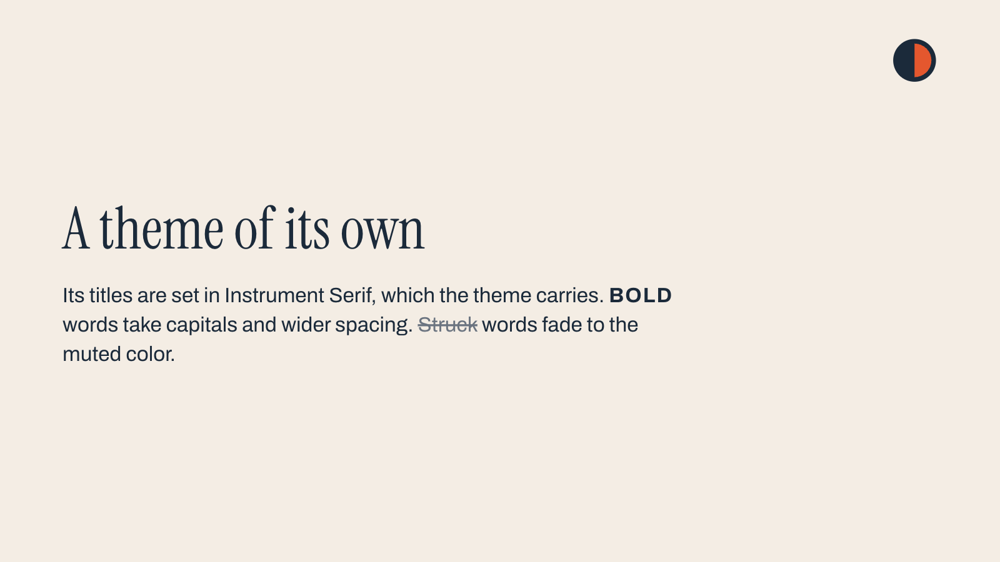
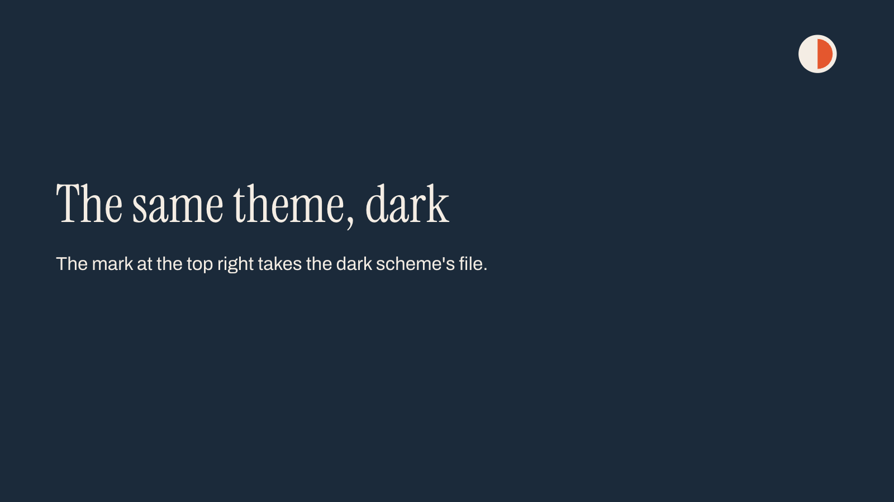

# Themes

A theme contains the fonts, colors, text styles and layouts used by its slides. The slide text is in `slides.md`.

A theme is stored under `themes/<key>/`. Set `"theme": "<key>"` in the .mdpoint file to select it. Each theme also has a UUID in `master.json` that identifies it independently of the folder name. Most examples use Basic, MarkdownPoint's default theme.

```
themes/basic/
  master.json             size, fonts, color schemes, text styles and what every slide shows
  title.json              one file per layout, named by the layout's key
  content-with-header.json
  ...
  fonts/                  the theme's own fonts, one .eot file per face
  media/                  the theme's own images
```

## Master, layouts and slides

The master applies to every slide. Layouts define the objects and placeholders for each kind of slide. A slide selects a layout and can add objects or override properties.

For a title placeholder, the layout sets its position and text style. Each slide supplies the title text in its Markdown block.

## Master

`master.json` contains the theme settings. Its `objects` appear behind the objects added to each slide. Basic's master includes a footer and a hidden slide number, both filled by fields:

```json
{"footer": "{{footer}}", "slide-number": "{{slide-number}}"}
```

## Color schemes

A scheme sets a color for each role. A role names how the color is used: `background`, `text` or `accent`, for example. Objects using a role follow the slide's scheme. A hex color stays the same across schemes.

Every theme has a `light` and a `dark` scheme. Another scheme, such as Basic's butter, states its `appearance`, light or dark:

```json
{
  "appearance": "light",
  "background": "#FBE991",
  "text": "#17120F",
  "muted": "#524843",
  "accent": "{brand.ember}",
  "stroke": "#17120F1F",
  "link": "#17120F"
}
```

`{brand.ember}` refers to the `ember` color under `brand.colors`. A scheme must set `background`. Omitted roles use the defaults for the scheme's `appearance`. See the [scheme reference](reference/v1.md#scheme) for those defaults.

## Text styles

A text object uses a named text style from the theme. Define every style used by the theme's layouts and slides; no style names are built in. Basic's `title` style is:

```json
{
  "font-family": "display",
  "font-size": 80,
  "font-weight": 700,
  "line-height": 1.05,
  "tracking": -0.025,
  "color": "text"
}
```

Set `font-family` to `display`, `body` or `mono`. The `fonts` map assigns a family to each role. Changing `fonts.body` changes the family used by text with the `body` role. A text style also sets size, weight, color and spacing.

The [font reference](reference/v1.md#fonts) lists the bundled families. Bundled and generic families, such as `serif` or `system-ui`, need no font files. For other families, include the font files with the theme. List one `.eot` file per face under `font-files`. MarkdownPoint stores these in the theme's `fonts` folder.

## Layouts

A layout defines a slide's initial objects. Basic's Title layout is:

```json
{
  "markdownpoint": "1.0",
  "kind": "layout",
  "scheme": "apricot",
  "overrides": {"footer": null, "slide-number": null},
  "objects": [
    {
      "id": "title",
      "type": "text",
      "placeholder": true,
      "frame": {"x": 120, "y": 470, "width": 1560, "height": 310},
      "text-style": "display",
      "vertical-align": "bottom"
    },
    {
      "id": "body",
      "type": "text",
      "placeholder": true,
      "frame": {"x": 120, "y": 800, "width": 1560, "height": 130},
      "text-style": "body",
      "color": "muted"
    },
    {
      "id": "eyebrow",
      "type": "text",
      "placeholder": true,
      "frame": {"x": 120, "y": 112, "width": 1560, "height": 48},
      "text-style": "meta",
      "font-weight": 600,
      "vertical-align": "center",
      "tracking": 0.06,
      "case": "upper"
    }
  ],
  "text": {
    "title": "Presentation title",
    "body": "Presentation subtitle",
    "eyebrow": "Author and date"
  }
}
```

`"placeholder": true` identifies an object filled with each slide's text. Slides using this layout put their text under `<!-- text: title -->`, `<!-- text: body -->` and `<!-- text: eyebrow -->`, by each placeholder's `id`. A placeholder's `name` is only the label MarkdownPoint shows for it.

The layout's `text` contains sample text for the layout chooser and theme editor. An empty placeholder shows nothing during a presentation. Use `overrides` to change a master object's properties on this layout. Set its override entry to `null` to remove the object.


## A theme of its own

The [own-theme example](examples/own-theme) carries Studio, a theme of its own, under `themes/studio/`. Its titles use Instrument Serif, a font under the SIL Open Font License. The theme holds one `.eot` file per face in its `fonts` folder, with the license beside them:

```json
{
  "Instrument Serif": [
    "fonts/InstrumentSerif-Regular-863059cec8fb37e2.eot",
    "fonts/InstrumentSerif-Italic-2d7eee1439e3c874.eot"
  ]
}
```

A text style's `marks` set how bold, italic, highlighted, struck-through and code words look. Studio's body shows bold words in capitals with wider spacing, and struck-through words in the muted color. `inset-bottom` keeps space under the last line:

```json
{
  "font-family": "body",
  "font-size": 40,
  "font-weight": 400,
  "line-height": 1.4,
  "color": "text",
  "inset-bottom": 24,
  "marks": {"bold": {"case": "upper", "tracking": 0.06}, "strikethrough": {"color": "muted"}}
}
```

The master's mark has a file for each scheme, so a dark slide shows the dark scheme's file:

```json
[
  {
    "id": "mark",
    "type": "image",
    "file": {"light": "media/mark-on-light.svg", "dark": "media/mark-on-dark.svg"},
    "frame": {"x": 1712, "y": 72, "width": 88, "height": 88},
    "alt": "Studio's mark"
  }
]
```

 

The master also sets a column grid, a baseline grid and two guides. MarkdownPoint shows them while you edit, never on a slide:

```json
{"columns": {"count": 12, "gutter": 24, "margin": 120}, "baseline": {"start": 120, "increment": 24}}
```

```json
[
  {"id": "center", "x": "50%", "name": "Center", "locked": true},
  {"id": "footer-line", "y": 960, "name": "Footer line"}
]
```

`unit-scale` is how many meters one canvas unit stands for in 3D. Studio's 0.01 makes a canvas unit a centimeter. `save` in `master.json` and in a layout is a save stamp. MarkdownPoint writes it while editing passes between people. Leave it as it is.

## Changing a theme by hand

The presentation can contain several themes. If the new theme is missing a layout used by your slides, MarkdownPoint copies that layout into it when you switch. The previous theme stays in the folder.

A change to master.json affects every slide. A change to a layout affects every slide that uses it.

MarkdownPoint picks up theme changes made outside the app while the presentation is open, unless the presentation is shared for editing together. If a layout can't be read, each slide on it shows “This slide can’t be shown”, and the problem is listed under “Issues” in the inspector. If the master can't be read, every slide shows it.

The reference lists every key of [master.json](reference/v1.md#master) and [a layout](reference/v1.md#layout).
